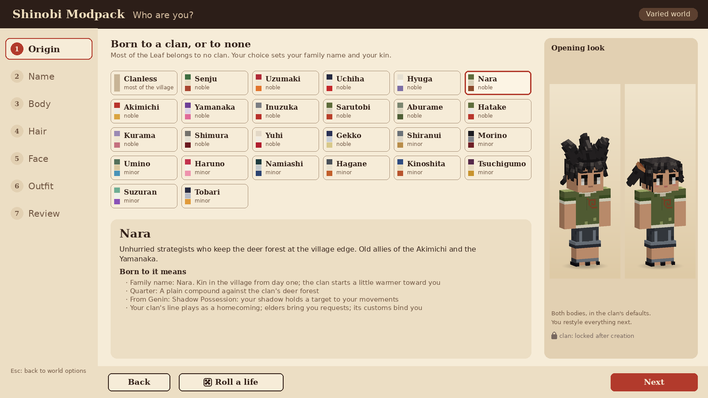
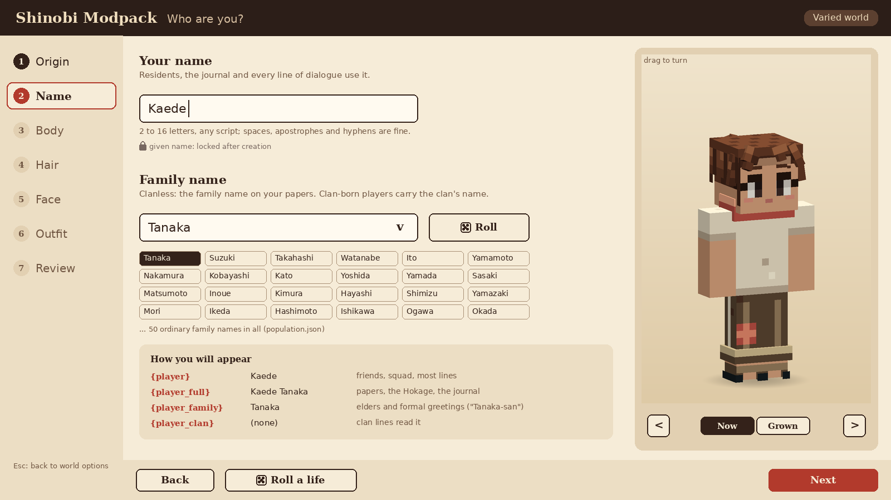
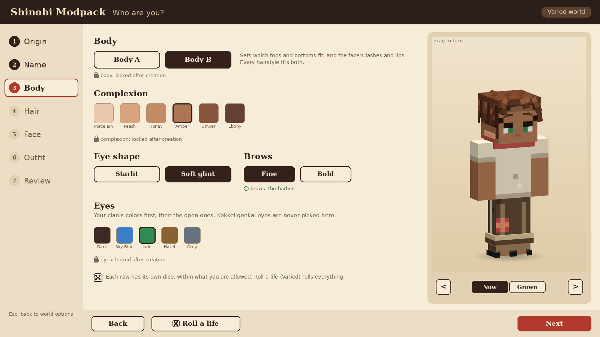
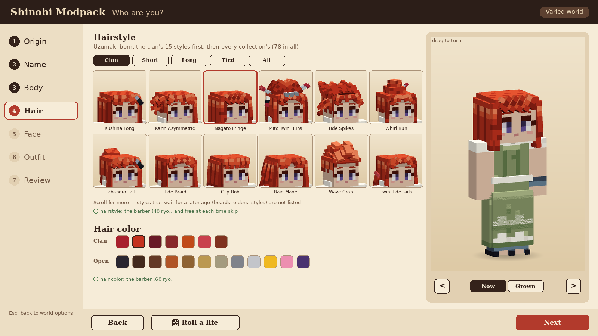
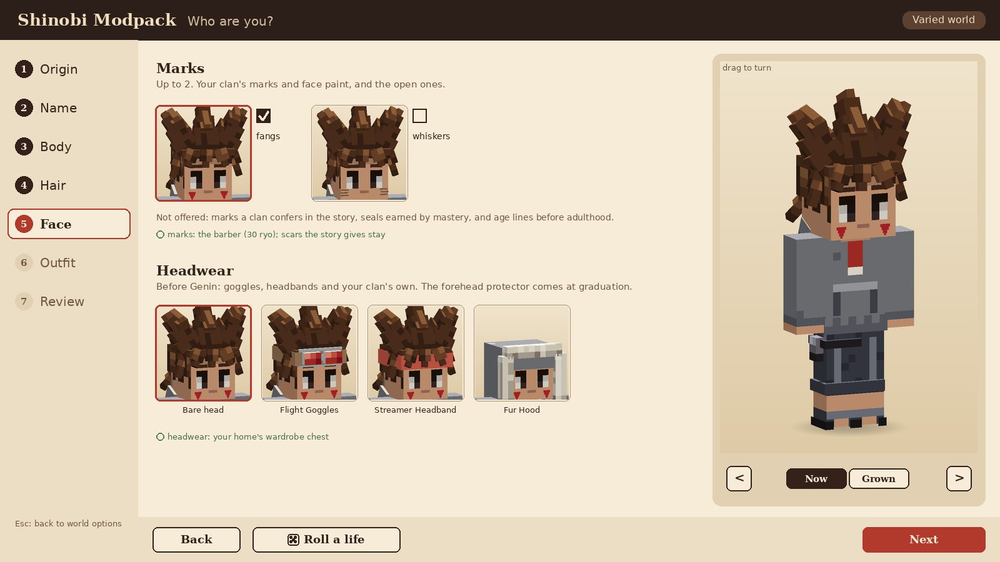
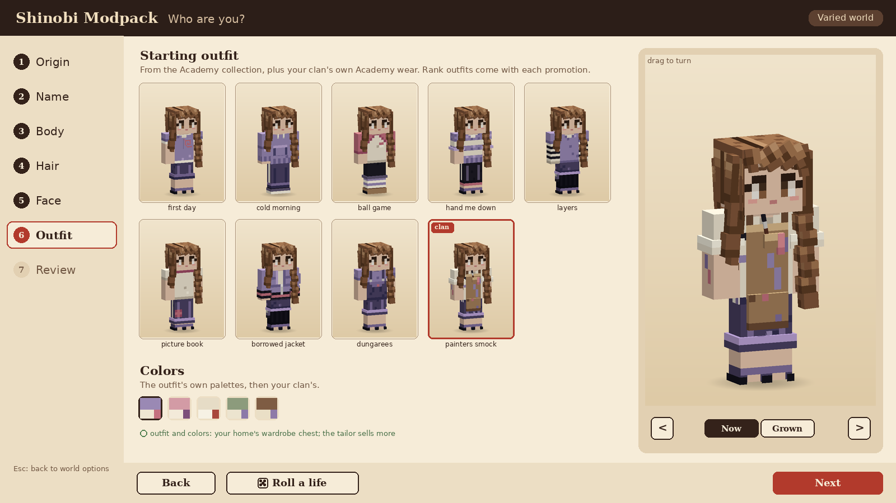
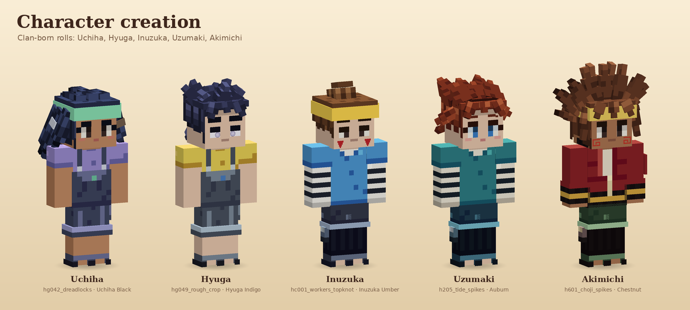

# Character creation

How a new game of the Shinobi Modpack begins: the world's options, then the creator that makes your
character, and how that character carries through the age stages. The player's look is built from
the same wardrobe pieces as the residents ([CLANS.md](CLANS.md), `tools/wardrobe/`), so whatever
the creator offers is a piece the village already wears.

**No spoilers here.** This file describes screens, rules and data. It says nothing about who you
are beyond what the opening shows; story content stays in the developers-only story bible.

| Piece | Where |
|---|---|
| The rules (authored) | [`tools/creator/creator.json`](tools/creator/creator.json) |
| The compiled rules the game and the server read | `src/main/resources/data/narutominecraft/creator/creator.json` |
| The tool: compile, `--check`, previews, mock-ups, `--roll` | [`tools/creator/creator.py`](tools/creator/creator.py), `preview.py`, `mockups.py` |
| The pure Java: age stages, the server's check, names, Roll a life, restyling, growing up | [`village/look`](village/look) (`dev.shinobi.village.look`) |
| Renders and mock-ups | [`docs/renders/creator/`](docs/renders/creator/) |

```
python3 tools/creator/creator.py              # compile the rules against the wardrobe
python3 tools/creator/creator.py --check      # validate, and fail if the compiled file is stale
python3 tools/creator/creator.py --samples    # sample players and the age-stage sheet
python3 tools/creator/creator.py --mockups    # the screens below
python3 tools/creator/creator.py --roll 42    # what Roll a life suggests for save seed 42
./gradlew :village:look:test                  # 28 tests (JDK 25)
```

## Contents

1. [At a glance](#1-at-a-glance)
2. [World creation first](#2-world-creation-first)
3. [Where the creator sits in the opening](#3-where-the-creator-sits-in-the-opening)
4. [The screens](#4-the-screens)
5. [The 25 clans and the clanless](#5-the-25-clans-and-the-clanless)
6. [Family, personality and nature](#6-family-personality-and-nature)
7. [Starting stats and kit](#7-starting-stats-and-kit)
8. [Locked and changeable](#8-locked-and-changeable)
9. [Randomising](#9-randomising)
10. [Age stages](#10-age-stages)
11. [How residents address you](#11-how-residents-address-you)
12. [Data](#12-data)
13. [Code, and what waits for Phase 0](#13-code-and-what-waits-for-phase-0)
14. [Open questions](#14-open-questions)

## 1. At a glance

| Step | You choose | Rule | Later |
|---|---|---|---|
| World | Classic or Varied, the save seed, difficulty, adventure rules, hand-sign input | [§2](#2-world-creation-first) | Difficulty and input in the settings; mode and seed never |
| 1 Origin | One of the 25 clans, or clanless | All 26 open; resets the look to the origin's opening look | Locked (marriage, an invitation or founding a clan later) |
| 2 Name | Your given name; a family name if clanless | Typed, 2 to 16 letters; clan-born carry the clan's name | Locked |
| 3 Body | Body A or B, complexion (6), eye shape, brows, eye color | Clan eyes first; kekkei genkai eyes never picked | Brows at the barber; the rest locked |
| 4 Hair | Hairstyle, hair color | Every collection's styles, plus your clan's; open colors plus your clan's | The barber; free at each time skip |
| 5 Face | Up to 2 marks; headwear | Clan marks for the clan-born; no forehead protector before Genin | Marks at the barber; headwear at home |
| 6 Outfit | A starting outfit and its colors | The Academy collection, plus the clan's own Academy wear and colors | Home's wardrobe chest, the tailor; rank outfits come with promotions |
| 7 Review | Confirm | Everything on one page with what locks | — |

The numbers in the compiled file today: the clanless choose from 63 hairstyles, 13 hair colors, 5
eye colors, 8 Academy outfits and 3 headwear; the clan-born add their clan's 15 or 16 hairstyles,
its colors, eyes, marks, its Academy outfits and palettes and its own headwear (75 to 79 styles at
the child stage).

## 2. World creation first

The vanilla Create World screen gains a **Shinobi** tab, filled before the creator opens. The save
stores every choice.


| Option | Choices | What it changes |
|---|---|---|
| **Mode** | Classic, Varied | **Classic:** the curated cast (squad, sensei, rival, families), a fixed order of side stories, a fixed apartment, curated shop stock. **Varied:** the save seed rolls the cast, families and clan populations, which side stories appear and in what order, shop stock and your apartment. The main story's beats are the same in both, and names are rolled in both ([ROADMAP §5](ROADMAP.md#world-creation-classic-or-varied)). In the creator, only Varied offers *Roll a life* ([§9](#9-randomising)). |
| **Save seed** | A 64-bit number, from the world seed unless typed | Every roll in the save comes from it, through one stream per system. In the creator it seeds *Roll a life* (`creator` stream) and the clanless family name you get if you do not pick one (`names` stream, key `player`). Same seed and pack version, same village. |
| **Difficulty** | Story (default), Shinobi, Hard | Parry and dodge windows, telegraphs, enemy damage, fatigue thresholds, death's level loss ([ROADMAP §7](ROADMAP.md#combat-in-the-beta)). Changeable any time; nothing in the creator depends on it. |
| **Adventure rules** | On (in the Leaf map), off | On: no breaking or placing blocks anywhere; doors, chests, stations, sitting and sleeping work, and furniture places in your own home ([ROADMAP §7](ROADMAP.md#adventure-rules)). Off only in builder mode, for making the map; in any other VF world it is a game rule, off by default. |
| **Hand signs** | Typed, radial | How signs are entered. Also in the settings at any time. |

## 3. Where the creator sits in the opening

The creator is the first thing in the prologue (ROADMAP §8, Ch 0). A new world loads to a dark,
quiet title card that asks *Who are you?*, and the creator opens over it; when you confirm, the
prologue's first scene plays. The creator itself says nothing about the story: it never explains
why you are where you are, and it shows no place, person or symbol from the prologue.

- **What you wear in the prologue:** your own hair, eyes and marks in plain, worn clothes
  (`prologue_look`: a striped sweater and patched trousers in a dusty palette, unisex). The outfit
  you chose in the creator is waiting at your apartment in Ch 1, with the rest of your start
  ([§7](#7-starting-stats-and-kit)). The review screen says so.
- **Your age:** 11 at the start; the child stage for the whole beta ([§10](#10-age-stages)).

## 4. The screens

Seven steps on a left rail; the preview of your character stays on the right on every step. You can
go back to any step at any time before confirming; a change of origin keeps every choice the new
origin also allows and swaps the rest for its opening look. Esc returns to the world options.

**The preview** is the player model exactly as the game draws it: the child stage's 0.78 scale with
the head 10% larger, your skin, hair, eyes (Living Eyes, blinking), marks and outfit. Drag to turn
it, or use the arrows. **Now / Grown** shows you at 11 or as an adult (scale 1.0, the hair the
Years Later mirror would suggest, a Jonin outfit of your origin): a preview only, so the choice of
a hairstyle never surprises you later.

### 1 Origin



A grid of 26 tiles: **Clanless** first, then the 15 noble and 10 minor clans, each with three chips
of its first palette. The detail panel shows a short neutral blurb and what being born to it means
([§5](#5-the-25-clans-and-the-clanless)); the right panel shows the origin's opening look on both
bodies. The tile order follows CLANS.md. Picking an origin first matters because it sets which
hair, colors, marks and outfits the later steps offer.

### 2 Name



- **Given name:** typed, 2 to 16 letters of any script, with spaces (not two in a row),
  apostrophes and hyphens; it must start with a letter. Braces, digits and symbols are refused, so
  token syntax can never enter a name (`Names.validateGiven`). The name is yours alone: it is never
  rolled, and it is not checked against the name pools (a player may share a name with a resident).
- **Family name:** a clan-born player carries the clan's name, shown and fixed. A clanless player
  picks one of the 50 ordinary family names of `population.json` (*the family name on your
  papers*), or presses Roll; leaving it unpicked takes the one the save's `names` stream rolls.
  Only the pool is offered, so a clanless player never carries a clan's name.
- **How you will appear:** the tokens dialogue uses, filled in ([§11](#11-how-residents-address-you)).

### 3 Body



- **Body A or B** (VF's male and female): which tops and bottoms fit (the wardrobe's `gender`), the
  face's lashes and lips (Living Eyes' `feminine`), and VF's chemistry rules. Every hairstyle fits
  both bodies; the hair grid lists them all, and the creator's opening looks prefer a style made for
  the body.
- **Complexion:** the six skin tones, open to everyone (`textures/body/0..5`). The opening look uses
  the clan pool's most common one.
- **Eye shape:** starlit or soft glint (the Living Eyes styles). **Brows:** fine or bold.
- **Eye color:** your clan's eye colors first, then the open ones (Dark, Sky Blue, Jade, Hazel,
  Grey). A clan's own colors are its members' alone. **The Hyuga-born have the Byakugan's pale
  eyes, always** (the row shows one locked swatch). **The Sharingan is never picked:** it awakens in
  the story for the Uchiha-born. No other kekkei genkai shows in the eyes at creation.

### 4 Hair



- **Hairstyles:** the clan-born see their clan's styles first (a *Clan* tab), then every
  collection's: the six shinobi collections' and the two civilian collections' (66 in all, 63 at
  the child stage). The clanless see the collections' styles. Another clan's styles are never
  offered: they are that clan's look. Tabs (Short, Long, Tied, All) filter by the pieces' tags when
  the game has them; the mock-up shows the Clan tab.
- **Styles that wait:** beards, sideburns, receding hairlines and elders' styles open at the teen
  or adult stage (`stage_hair`, 17 styles), on the Years Later mirror or at the barber.
- **Hair color:** the clan's colors first (its own ramps, then the shared ones its pool uses), then
  the open ones: Raven Black, Espresso, Chestnut, Auburn, Ginger, Honey Brown, Wheat Blonde, Ash
  Blonde, Silver Grey, Snow White, Sun Blond, Blossom Pink, Violet. Reserved: *Uchiha Black* to the
  Uchiha, *Hokage Gold* to a Hokage's fixed look.

### 5 Face



- **Marks, up to two:** the clan-born pick from their clan's marks (fang paint, swirls, scars,
  beauty marks) and the open whisker marks; the clanless from the open ones. The opening look
  carries the marks almost every member of the clan wears (a pool chance of 0.5 or more: the
  Inuzuka fangs, the Akimichi swirls, the Gekko's tired eyes).
- **Never chosen:** marks a clan confers in the story (the Hyuga branch seal), seals earned by
  mastery (the Senju and Uzumaki diamond seals), and age lines before the adult stage.
- **Headwear, before Genin:** a bare head, flight goggles or a streamer headband for everyone, and
  the clan's own pieces for the clan-born (goggles, hachimaki, hoods, hairpins, a cloth mask, round
  shades: `start_headwear` per clan in `creator.json`). No forehead protector until graduation, and
  no ANBU or Root masks.

### 6 Outfit



- **Outfits:** the Academy collection's Academy outfits (first day, cold morning, ball game, hand
  me down, layers, picture book, borrowed jacket, dungarees), plus the clan's own Academy outfits
  for the clan-born (one or two for 20 of the clans; the Aburame, Nara, Yamanaka, Shimura and Yuhi
  have none, and wear the collection's in their colors). Only outfits that fit your body are shown.
- **Colors:** the outfit's own palettes, then, for the clan-born, every one of the clan's palettes:
  any Academy outfit can be worn in the clan's colors.
- Mixing a top with another outfit's bottom is not in the creator; the tailor sells variants later.

### 7 Review


Your character large, a small *one day* adult preview, and every choice in a list with a lock or a
*changeable later* mark and an *edit* link back to its step. Confirming sends the choice to the
server, which checks it against the same rules (`CreatorRules.validate`); the client only ever
offers allowed choices, so a refusal means a mismatched pack. Then the prologue begins.

## 5. The 25 clans and the clanless

Every clan is pickable, alongside clanless ([ROADMAP §2](ROADMAP.md#2-decisions)). The blurbs are
in `creator.json` (each at most 200 characters) and say nothing a resident would not.

| Origin | Standing | Who they are | Quarter | From Genin | Kekkei genkai | Welcome |
|---|---|---|---|---|---|---|
| **Clanless** | most of the village | Most of the Leaf belongs to no clan: civilians' children and shinobi of ordinary families. You start even with everyone and earn your place yourself. | Your apartment block, like everyone | One lesser technique per friendly clan (friend at level 7) | — | The outsider's test, in every clan |
| **Senju** | noble | The founders' clan: calm, generous, with a long memory. A living tree grows through their hall. | A compound beside the Hokage Residence, under the Rock | Wood Release: short-lived wooden barriers and binding roots | Wood Release | Beta 2 |
| **Uzumaki** | noble | Few living members, a memorial shrine with the spiral crest, and the finest sealing tradition in the Leaf. Loud, warm, long-lived. | A small compound next to the Senju, mostly a memorial | Sealing chains and a deep chakra pool | — | Beta 2 |
| **Uchiha** | noble | Proud, private and quick to take offence; they run the Military Police from their walled quarter at the village edge. | A walled compound on the village's outskirts | The Sharingan's sight: earlier warnings, wider parries, techniques learned by watching | Sharingan | Beta 2 |
| **Hyuga** | noble | Formal and exact, split into a main house and a branch house. Every Hyuga has the pale eyes of the Byakugan. | A formal estate a short walk from the Residence | Byakugan and the Gentle Fist: sight through walls, strikes that drain chakra | Byakugan | Beta 2 |
| **Nara** | noble | Unhurried strategists who keep the deer forest at the village edge. Old allies of the Akimichi and the Yamanaka. | A plain compound against the clan's deer forest | Shadow Possession: your shadow holds a target to your movements | — | Beta 2 |
| **Akimichi** | noble | Big-hearted and proud of it; their table is always open. Old allies of the Nara and the Yamanaka. | A compound with a big kitchen hall, by the market street | Expansion and the Human Boulder | — | Beta 2 |
| **Yamanaka** | noble | Florists and sensors on the main street; the flower shop out front, a quiet hall behind. Old allies of the Nara and the Akimichi. | A compound on the main street, behind the flower shop | Mind Transfer (later tiers) and sensing | — | Beta 2 |
| **Inuzuka** | noble | Loud, loyal ninken handlers who live by the pack. Children get their first pup at the clan day. | Kennels and a clinic by the main gate | Fang over Fang, together with your ninken | — | Beta 2 |
| **Sarutobi** | noble | An old council family that carries the Will of Fire: warm, stubborn, fond of long scarves. | A family house near the Residence with a fire-training yard | Fire mastery and the clan staff | — | Beta 2.5 |
| **Aburame** | noble | Private, patient and precise; they share their bodies with the kikaichu insects and keep their faces behind lenses and collars. | A dark timber house with insect gardens | The insect swarm: it follows a target, drains chakra and marks it | — | Beta 2.5 |
| **Hatake** | noble | A house almost empty; everyone respects the name, few visit. Silver hair and ninken run in the family. | A lone, worn family house on a quiet lane | A ninken tracker and the chakra sabre | — | Beta 2.5 |
| **Kurama** | noble | A refined household of painters whose brushes make illusions. A polite rivalry with the Yuhi's school. | A house with a painting studio on the old artists' lane | Painted illusion: a genjutsu world closes over a target | — | Beta 2.5 |
| **Shimura** | noble | A stern, quiet council family that keeps to itself. Disagrees with the Sarutobi about everything. | A stern house close to the Hokage Rock | Vacuum blades and sealing | — | Beta 2.5 |
| **Yuhi** | noble | The genjutsu clan of crimson eyes and old trees; their grove is a training ground for illusions. | A house in a grove of old trees, in the garden district | Tree binding: the target sees itself bound while you step behind it | — | Beta 2.5 |
| **Gekko** | noble | A quiet family of swordsmen of the Crescent Moon: pale, tired-eyed, always with a blade at hand. | A kenjutsu dojo with a moon-viewing platform, by the training grounds | Dance of the Crescent Moon: two short-lived clones strike with you | — | Beta 2.5 |
| **Shiranui** | minor | Cool-headed senbon specialists of the Hokage's guard, easy smiles and all. | A family house near the gate barracks | — (an ordinary family) | — | Beta 2.5 |
| **Morino** | minor | Stern interrogators in long coats, and surprisingly gentle at home. | A severe house near the police HQ | — (an ordinary family) | — | Beta 2.5 |
| **Umino** | minor | The teachers' family: half the village was taught by an Umino. | Teachers' houses in the Academy streets | — (an ordinary family) | — | Beta 2.5 |
| **Haruno** | minor | A cheerful merchant household whose children became ninja. | A neat family house and garden on a residential street | — (an ordinary family) | — | Beta 2.5 |
| **Namiashi** | minor | Quiet swordsmen of the Hokage's guard, the wave-foot family. | A small footwork dojo near the training grounds | — (an ordinary family) | — | Beta 2.5 |
| **Hagane** | minor | Gate guards and messengers, with a metalworker's shop beside the forge. | A metalworker's shop on the market street | — (an ordinary family) | — | Beta 2.5 |
| **Kinoshita** | minor | The carpenters and builders who raised and rebuilt the Leaf's houses; the furniture is made in their yard. | The carpenters' and builders' yard | — (an ordinary family) | — | Beta 2.5 |
| **Tsuchigumo** | minor | A mountain shrine clan that lives in the Leaf but keeps its own counsel. | Stone houses by the quarry | Earth binding: earth-style ninjutsu and a web-like trap | — | Beta 2.5 |
| **Suzuran** | minor | Herbalists of the hospital gardens, with lily blood that shrugs off poison. | Herbalists' houses by the hospital | Herbalist: immune to poison, poultices and coatings at the workbench | — | Beta 2.5 |
| **Tobari** | minor | Silent scouts and night watchmen of the dark lanes behind the wall. | Shuttered houses behind the wall | Smothering: silence around you at night | — | Beta 2.5 |

**What being born to a clan means:**

- **Your name and kin.** You carry the clan's family name. The clan is family from day one: its
  members start 8 affection and 6 trust warmer toward you, its elders bring you requests
  (`elder_request` hooks), and its customs bind you ([BONDS.md §18](BONDS.md#18-village-scale)).
  Its gate and main hall stand from Beta 1 (ROADMAP §6), so you can visit from the first morning.
- **Its look.** The clan's hairstyles, colors, eyes, marks, Academy outfits and palettes are offered
  to you and to no one else.
- **Its quarter.** You live in your apartment like every Academy student; from Chunin you may move
  into your clan's quarter ([ROADMAP §11](ROADMAP.md#homes-after-the-beta)).
- **Its arts, from Genin.** The clan's elder teaches the first tier of the clan technique in Ch 12,
  and the first kekkei genkai stage arrives in Beta 2 (Byakugan, Wood Release) or Beta 3 (the
  Sharingan). Nothing of it is active at creation: every origin starts with the same stats
  ([§7](#7-starting-stats-and-kit)). The seven minor clans without an ability have no clan
  technique: they are families of the village, with their own quarters, lines and standing.
- **Its line.** The clan's quest line plays as a homecoming instead of an outsider's test, and puts
  you inside the clan's own politics ([SIDE_QUESTS.md §4](SIDE_QUESTS.md#4-clan-quest-lines)).
  Welcome quests ship in two waves: the eight great clans in Beta 2, the other 17 in Beta 2.5; a
  wave-2 clan's quarter, residents, technique and generated quests are there from Beta 2 all the same.
- **Conditions:** quests read it as `clan` and `clan_status: born`.

**Clanless** means the opposite at every point: an ordinary family name, every collection's look,
an even start with every clan and standing earned with `group:clanless`; from Genin, one lesser
technique from each clan where a friend reaches level 7 (`clan_friendship`); clan lines as the
outsider's test, which can end in an invitation to join (`clan_status: clanless`).

## 6. Family, personality and nature

- **Family background.** The opening's facts are the same for everyone: you arrive in the village
  an orphan, the Hokage gives you an apartment and an Academy place, and a stipend pays your way
  (ROADMAP §1). The creator adds only a family name: the clan's, or for the clanless the name on
  your papers. It asks nothing about parents, a hometown or a past, and it offers no background
  choices: the opening is the same for every origin.
- **No personality pick.** The bond system gives residents personalities and leaves the player
  without one: your chemistry with a resident is the pair's seeded spark plus their warmth and
  openness ([BONDS.md §2](BONDS.md#2-the-meters)), and who you are is what you do. The creator has
  no traits, values or dreams.
- **No nature at creation.** Your first chakra nature is chosen at the nature ceremony in Ch 12
  (ROADMAP §11, "Elemental natures"), and the creator neither picks nor hints at it, so the ceremony
  stays a real choice. The clan blurbs name clan arts, not natures. (Asked of the combat session:
  whether the ceremony should mark a clan's traditional nature as a suggestion; [§14](#14-open-questions).)

## 7. Starting stats and kit

Every origin starts with the same numbers; clans differ by their arts from Genin, not by a head
start. Proposed here, owned by the combat and items sessions (their registries hold the ids):

| What | Start | Owner |
|---|---|---|
| Level, XP | Level 1, 0 XP; rank Academy (floor 1) | Progression (`ranks.json`) |
| Hearts | 10 (+1 every 6 levels) | Combat |
| Chakra | The level-1 maximum (+3 a level, ROADMAP §7); the bar appears in Ch 3 | Combat |
| Techniques | None; Clone, Transformation and Substitution are learned in Beta 1 | Combat |
| Nature | None until Ch 12 | Combat |
| Clan technique, kekkei genkai | None until Genin (Ch 12; the Sharingan in Beta 3) | Combat |
| In the prologue | Nothing but the prologue clothes | Items |
| At the apartment, Ch 1 | Your chosen outfit (in the wardrobe chest), a futon or bed, a chest, the apartment key; the stipend's first 30 ryo | Items, Life |
| From the instructor, Ch 2 | Practice kunai and practice shuriken | Items |

## 8. Locked and changeable

| Choice | After creation | Where | Cost |
|---|---|---|---|
| Given name | Locked | — | — |
| Family name | Locked; changes only by marriage or joining a clan | Life and Core glue | — |
| Origin (clan) | Locked; a clan can be joined by marriage or invitation, or founded | Life and Progression | — |
| Body | Locked | — | — |
| Complexion | Locked | — | — |
| Eye shape | Locked | — | — |
| Eye color | Locked; a kekkei genkai shows itself on its own | — | — |
| Brows | Changeable | Barber | free with a haircut |
| Hairstyle | Changeable | Barber; free on the Years Later mirror | 40 ryo |
| Hair color | Changeable | Barber | 60 ryo |
| Marks | Changeable (chosen marks and face paint; scars the story gives stay) | Barber | 30 ryo |
| Outfit and colors | Changeable: every outfit you own | Home's wardrobe chest; the tailor sells palettes and variants (100 to 600 ryo, ROADMAP §7) | free |
| Headwear | Changeable; from Genin the forehead protector is one of them | Home's wardrobe chest | free |

Every restyle is checked against the creator's own lists for your origin and current stage
(`Restyle.apply`), so the barber can never reach what the creator could not. **The barber** is a new
civilian shop (asked of the map: a chair in the bath house or beside the tailor). Costs are data
(`changes` in `creator.json`), tuned with the economy.

## 9. Randomising

- **Dice on every row, in both modes:** each row (complexion, eyes, hairstyle, hair color, marks,
  outfit, colors, headwear, the family name) has a die that picks within what you are allowed. Row
  dice are a convenience and use the client's own randomness.
- **Roll a life, Varied only:** one button on every step rolls a whole character the way Varied
  rolls the cast: an origin by the shinobi groups' population weights (so about half of the rolls
  are clanless and a Hatake is rare), then the whole look from that origin's own weighted pools (the
  residents' pools: common colors come up more often, marks at their pool chances, whiskers 1 in
  20 for the clanless), then a family name. It draws from the save seed's `creator` stream, so **the
  same seed always suggests the same character** (`creator.py --roll <seed>`). It never touches the
  name you typed. Classic offers no Roll a life: a curated world leaves the choosing to you.
- **Parity:** `LifeRoll` (Java) and `creator.py` (Python) roll the same numbers; the compiled file
  carries six seeds' rolls and the Java tests replay them.





## 10. Age stages

The model is scaled, never swapped (ROADMAP §7, "Growing up"), so every piece fits every stage.

| Stage | Age | When | Scale | Head |
|---|---|---|---|---|
| Child | 11 to 12 | Creation, the whole beta | 0.78 (vanilla `scale`: hitbox, eye height 1.26, reach) | 1.1, drawn by the player poser |
| Teen | 13 to 17 | The first time skip, opening the Chunin arc (after the beta) | 0.9 | 1.0 |
| Adult | 18 and up | The second time skip, before the Jonin trial | 1.0, for good | 1.0 |


**How your choices carry across:**

- **Locked choices never change:** name, body, complexion, eye shape and color, origin.
- **Hair grows.** At each time skip the **Years Later mirror** opens: a free restyle of hair, hair
  color, brows, marks, outfit and headwear, from the new stage's lists. It preselects the style your
  hair grows into (`grows_into`: short twin tails become low pigtails, then a tied long sheet; a
  messy mop becomes shaggy layers) and you may pick again. Styles that waited for the stage
  (beards, elders' styles) open here.
- **Outfits follow the rank.** The child stage wears Academy outfits; a promotion gives the rank's
  outfit (Genin at graduation, Chunin in Beta 3, Jonin later) into the wardrobe chest, and at a time
  skip an outfit the new stage no longer offers becomes the stage's outfit for your rank, keeping
  your colors when it can (`GrowUp.grow`). Teens wear Genin and Chunin outfits; adults Chunin,
  Jonin, ANBU and Kage. The clan-born keep their clan's outfits and palettes at every stage.
- **Marks** the new stage opens (age lines for adults) become available; chosen marks stay.
- **Headwear** gains every shinobi collection's and your clan's pieces from the teen stage, masks
  that cover the face excepted (ANBU masks come with the ANBU branch).


## 11. How residents address you

Text never contains your name. The creator fills these tokens (`Names.tokens`), next to ROADMAP's
`{name:<role>}`:

| Token | Is | Example |
|---|---|---|
| `{player}` | Your given name | Kaede |
| `{player_family}` | Your family name | Tanaka, or Hyuga |
| `{player_full}` | Given and family | Kaede Tanaka |
| `{player_clan}` | Your clan's name, empty for the clanless | Hyuga |

Proposed for the dialogue session, which owns the pools:

| Speaker | Clan-born | Clanless |
|---|---|---|
| Friends, classmates, the squad | `{player}` | `{player}` |
| Adults, shopkeepers, elders of other clans | `{player_family}` with a polite suffix, or *the {player_clan} child* | `{player_family}` with a polite suffix, or *the Academy kid* |
| Your own clan | `{player}`, *cousin*, kin words | — |
| The Hokage, papers, the journal | `{player_full}` | `{player_full}` |
| Strangers by rank | *Academy student*, then *Genin*, by rank pools (ROADMAP §7) | the same |

Dialogue reads `clan`, `clan_status` and `rank_at_least` to pick a line; no line depends on the
spelling of a name.

## 12. Data

**`tools/creator/creator.json` (authored)** holds only rules; every piece list is resolved from the
wardrobe, so a new clan hairstyle or Academy outfit appears in the creator with no edit here:

| Key | What |
|---|---|
| `stages` | Ages, scale, head scale and outfit ranks per stage |
| `name` | Length limits and the allowed characters |
| `bodies`, `complexions`, `eye_styles`, `brows`, `max_marks` | The fixed choices |
| `open` | What everyone may pick: every collection's hair, the open hair and eye colors and marks, the Academy collection's Academy outfits, the open headwear |
| `never_at_creation`, `reserved` | Ids no one picks (with the reason), and shared ids that belong to one clan |
| `stage_marks`, `stage_hair` | Marks and styles that wait for a later stage |
| `prologue_look` | The prologue's clothes |
| `changes`, `time_skip_restyle` | Where each choice can change, and its cost |
| `grows_into` | The mirror's suggested grown styles |
| `default_overrides` | Opening looks that differ from the computed ones |
| `roll_open_mark_chance` | Roll a life's chance of an open mark for the clanless |
| `clanless`, `clans` | Each origin's blurb, what being born to it means, its technique, kekkei genkai, quarter, starting headwear and locks |

**The compiled file** (`data/narutominecraft/creator/creator.json`, about 370 KB) is what the game
loads: one table of every outfit any origin may wear (top, bottom, rank, palettes, the bodies it
fits), the population weights for Roll a life, and per origin its hair, hair and eye colors, clan
palettes, per-stage marks, headwear and outfits, its opening looks per body, its Roll a life
weights, and the six parity rolls.

**`creator.py --check`** fails on: clans missing from or unknown to the wardrobe; open colors or
marks that belong to a clan or are also forbidden; unknown ids anywhere; a forehead protector or a
mask among starting headwear; a clan's colors, marks or hair reaching another origin; a forbidden id
at the child stage; an origin that cannot dress either body at some stage; incompatible outfit
pieces; a prologue look that does not fit both bodies; a blurb over 200 characters; an opening look
or a parity roll the server's check would refuse; a family name the story bible reserves for its
own characters (read from the bible, so it is written nowhere else); and a stale compiled file.

## 13. Code, and what waits for Phase 0

**Built now:** `village/look`, a Minecraft-free Gradle module of the multi-project (java-library,
JUnit 5, release 25), the way `life/bonds` is built. The Village mod depends on it in Phase 0
(`implementation project(':village:look')`).

| Class | Does |
|---|---|
| `AgeStage` | The three stages: scale, head scale, eye height, the stage after N time skips |
| `Look` | The player's look, with the save's map form |
| `CreatorRules` | Reads the compiled file; each origin's choices per stage; opening looks; the server's `validate` |
| `Names` | Given-name rules, the family name (clan, pool or the `names` stream), the `{player}` tokens |
| `LifeRoll` | Roll a life on the `creator` stream, the same numbers as `creator.py` |
| `Restyle` | Venues (barber, home, the mirror), costs, checked changes |
| `GrowUp` | Carrying a look into the next stage |
| `Seeds`, `Json` | The save seed's streams (the same as `life/bonds`; Core's `SaveSeed` later); a small JSON reader |

Tests (28): the stages agree with the compiled file; every opening look and every Roll a life of
400 seeds passes the server's check; Java and Python rolls agree; rolls follow the population; clan
pieces stay with their clan; the Byakugan is locked for the Hyuga and the Sharingan never offered;
conferred marks and elders' styles wait; no protector before Genin; names and tokens; the barber,
the home and the mirror; every opening look grows into an allowed teen and adult look.

**Waits for Phase 0:**

- The **Shinobi tab** on the Create World screen and the save's mode and seed (Core).
- The **creator screen** (Village, client): the seven steps, the live preview with the player
  poser's head scale, the stage toggle, row dice and Roll a life, Minecraft widgets at every GUI
  scale; a network payload carrying the look to the server, `CreatorRules.validate` on receipt, and
  the look on Core's player record.
- **Age-stage scaling** on the real player (the `scale` attribute and the poser's head), driven by
  `AgeStageChanged`.
- The **barber** (a VF-style shop at a map anchor), the **wardrobe chest** in furnish mode, the
  **Years Later mirror** after a `time_skip` action, the **prologue look** swap at Ch 1.
- Loading the compiled file through Minecraft's resource manager (the module's `CreatorRules` takes
  the parsed map).

## 14. Open questions

For the owner:

1. **Roll a life in Classic.** Today Classic has row dice but no Roll a life. Should Classic have
   it too (still seeded)?
2. **Clanless family name.** Only the 50 ordinary names are offered, so nobody types a clan's name
   or an odd one. Should a clanless player be able to type their own family name?
3. **Bodies.** Two bodies, labelled A and B, as VF has. Is that right, or should the labels say
   boy and girl?
4. **Whisker marks** are open to everyone (one shared mark today). Keep them, or make the open marks
   a few freckles and scars instead (new marks for the wardrobe)?
5. **Clan-born hair colors.** The clan-born may take any open color too (a parent from outside the
   clan), with the clan's colors listed first. Or should they keep to the clan's colors?

Asked of the sibling sessions (owners decide):

- **Combat:** the level-1 chakra, hearts and the starting numbers (§7); whether the Uzumaki chakra
  pool and the Suzuran poison immunity are innate from creation or wait for Genin like every other
  clan art (proposed: Genin); whether the nature ceremony suggests a clan's traditional nature;
  clan technique tiers by rank.
- **Items:** the Ch 1 apartment kit and the practice tools (§7) as ids in the items registry; the
  wardrobe chest as an item or a furniture block.
- **Dialogue:** the four `{player}` tokens and the address table (§11).
- **Map:** a barber's chair (the bath house or beside the tailor).
