# Character creation

How a new game of the Shinobi Modpack begins: the world's options, then the creator that makes your
character, and how that character carries through the age stages. The player's look is built from
the same wardrobe pieces as the residents ([CLANS.md](CLANS.md), `tools/wardrobe/`), so whatever
the creator offers is a piece the village already wears.

**For now, you are born to no clan.** The creator makes one kind of character: an orphan of no
clan, with an ordinary family name, who starts even with the whole village. Your own power comes
later, through the story and your bonds ([Kindling Bond](ROADMAP.md#kindling-bond)). Every clan's
creator rules stay in the data, so clan-born play can return as an option
([§12](#12-clan-born-play-a-later-option)).

**No spoilers here.** This file describes screens, rules and data. It says nothing about who you
are beyond what the opening shows; story content stays in the developers-only story bible.

| Piece | Where |
|---|---|
| The rules (authored) | [`tools/creator/creator.json`](tools/creator/creator.json) |
| The compiled rules the game and the server read | `src/main/resources/data/narutominecraft/creator/creator.json` |
| The tool: compile, `--check`, previews, mock-ups, `--roll` | [`tools/creator/creator.py`](tools/creator/creator.py), `preview.py`, `mockups.py` |
| The pure Java: age stages, the server's check, names, Roll a life, restyling, growing up | [`village/look`](village/look) (`dev.shinobi.village.look`) |
| Renders and mock-ups | [`docs/renders/creator/`](docs/renders/creator/) |

```
python3 tools/creator/creator.py              # compile the rules against the wardrobe
python3 tools/creator/creator.py --check      # validate, and fail if the compiled file is stale
python3 tools/creator/creator.py --samples    # sample players and the age-stage sheet
python3 tools/creator/creator.py --mockups    # the screens below
python3 tools/creator/creator.py --roll 42    # what Roll a life suggests for save seed 42
./gradlew :village:look:test                  # 31 tests (JDK 25)
```

## Contents

1. [At a glance](#1-at-a-glance)
2. [World creation first](#2-world-creation-first)
3. [Where the creator sits in the opening](#3-where-the-creator-sits-in-the-opening)
4. [The screens](#4-the-screens)
5. [Who you are at the start](#5-who-you-are-at-the-start)
6. [Starting stats and kit](#6-starting-stats-and-kit)
7. [Locked and changeable](#7-locked-and-changeable)
8. [Randomising](#8-randomising)
9. [Age stages](#9-age-stages)
10. [How residents address you](#10-how-residents-address-you)
11. [Data](#11-data)
12. [Clan-born play: a later option](#12-clan-born-play-a-later-option)
13. [Code, and what waits for Phase 0](#13-code-and-what-waits-for-phase-0)
14. [Open questions](#14-open-questions)

## 1. At a glance

| Step | You choose | Rule | Later |
|---|---|---|---|
| World | Classic or Varied, the save seed, difficulty, adventure rules, hand-sign input | [§2](#2-world-creation-first) | Difficulty and input in the settings; mode and seed never |
| 1 Name | First name, last name, pronouns | First name typed (2 to 16 letters); last name an ordinary family name, picked or rolled, never a clan's; the screen says *no clan* | Names locked; pronouns in the settings |
| 2 Body | Body A or B, complexion (6), eye shape, brows, eye color (5) | Open to everyone | Brows at the barber; the rest locked |
| 3 Hair | Hairstyle (63), hair color (13) | Every collection's styles; clan styles and colors are not offered | The barber; free at each time skip |
| 4 Face | Up to 2 marks; headwear | No forehead protector before Genin | Marks at the barber; headwear at home |
| 5 Outfit | A starting outfit and its colors | The Academy collection's 8 Academy outfits | Home's wardrobe cabinet, the tailor; rank outfits come with promotions |
| 6 Roots | Temperament, knack, affinity | Flavor and small leanings, never a story choice | Locked; the Genin ceremony still offers every nature |
| 7 Review | Confirm | Everything on one page with what locks | — |

## 2. World creation first

The vanilla Create World screen gains a **Shinobi** tab, filled before the creator opens. The save
stores every choice.

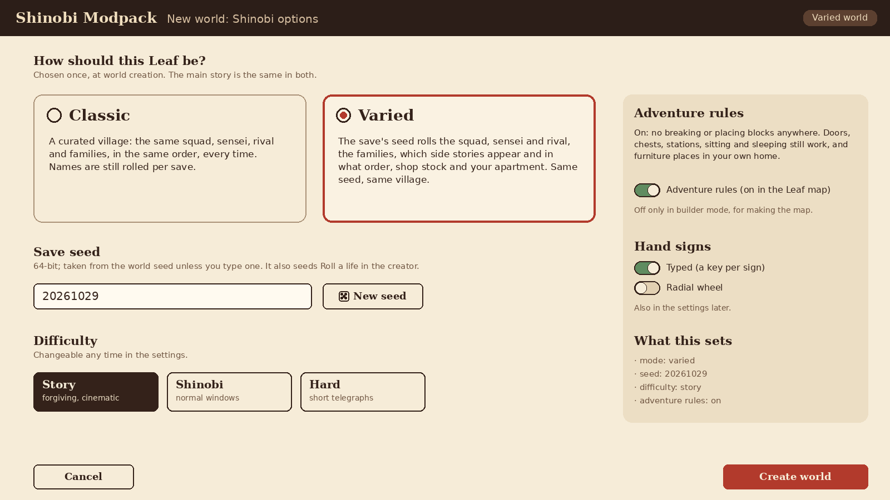

| Option | Choices | What it changes |
|---|---|---|
| **Mode** | Classic, Varied | **Classic:** the curated cast (squad, sensei, rival, families), a fixed order of side stories, a fixed apartment, curated shop stock. **Varied:** the save seed rolls the cast, families and clan populations, which side stories appear and in what order, shop stock and your apartment. The main story's beats are the same in both, and names are rolled in both ([ROADMAP §5](ROADMAP.md#world-creation-classic-or-varied)). In the creator, only Varied offers *Roll a life* ([§8](#8-randomising)). |
| **Save seed** | A 64-bit number, from the world seed unless typed | Every roll in the save comes from it, through one stream per system. In the creator it seeds *Roll a life* (`creator` stream) and the last name you get if you do not pick one (`names` stream, key `player`). Same seed and pack version, same village. |
| **Difficulty** | Story (default), Shinobi, Hard | Parry and dodge windows, telegraphs, enemy damage, fatigue thresholds, death's level loss ([ROADMAP §7](ROADMAP.md#combat-in-the-beta)). Changeable any time; nothing in the creator depends on it. |
| **Adventure rules** | On (in the Leaf map), off | On: no breaking or placing blocks anywhere; doors, chests, stations, sitting and sleeping work, and furniture places in your own home ([ROADMAP §7](ROADMAP.md#adventure-rules)). Off only in builder mode, for making the map; in any other VF world it is a game rule, off by default. |
| **Hand signs** | Typed, radial | How signs are entered. Also in the settings at any time. |

## 3. Where the creator sits in the opening

The creator is the first thing in the prologue (ROADMAP §8, Ch 0). A new world loads to a dark,
quiet title card that asks *Who are you?*, and the creator opens over it; when you confirm, the
prologue's first scene plays. The creator itself says nothing about the story: it never explains
why you are where you are, and it shows no place, person or symbol from the prologue.

- **What you carry and wear in the prologue:** the one key item the creator gives you
  ([§6](#6-starting-stats-and-kit)), and your own hair, eyes and marks in plain, worn clothes
  (`prologue_look`: a striped sweater and patched trousers in a dusty palette, unisex). The outfit
  you chose is waiting at your apartment in Ch 1, with the rest of your start
  ([§6](#6-starting-stats-and-kit)). The review screen says so.
- **Your age:** 11 at the start; the child stage for the whole beta ([§9](#9-age-stages)).

## 4. The screens

Seven steps on a left rail; the preview of your character stays on the right on every step. You can
go back to any step at any time before confirming. Esc returns to the world options.

**The preview** is the player model exactly as the game draws it: the child stage's 0.78 scale with
the head 10% larger, your skin, hair, eyes (Living Eyes, blinking), marks and outfit. Drag to turn
it, or use the arrows. **Now / Grown** shows you at 11 or as an adult (scale 1.0, the hair the
Years Later mirror would suggest, a Jonin outfit): a preview only, so a hairstyle never surprises
you later.

### 1 Name

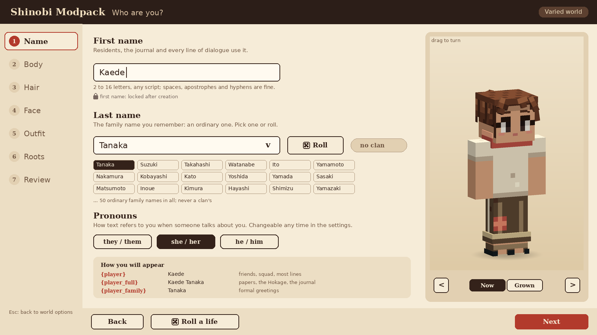

- **First name:** typed, 2 to 16 letters of any script, with spaces (not two in a row),
  apostrophes and hyphens; it must start with a letter. Braces, digits and symbols are refused, so
  token syntax can never enter a name (`Names.validateGiven`). It is yours alone: never rolled, and
  not checked against the name pools (a player may share a first name with a resident).
- **Last name:** one of the 50 ordinary family names of `population.json` (*the family name you
  remember*), picked from the list or rolled; leaving it unpicked takes the one the
  save's `names` stream rolls. Only that pool is offered, so a last name never matches a clan, and a
  *no clan* tag sits beside the field.
- **Name order:** first name, then last name, everywhere: *Kaede Tanaka*.
- **Pronouns:** they/them, she/her or he/him, preselected from the body and independent of it. Text
  never genders the player directly; when someone talks *about* you, lines use `{they:player}`,
  `{them:player}`, `{their:player}` ([§10](#10-how-residents-address-you)). Changeable any time in
  the settings.

### 2 Body

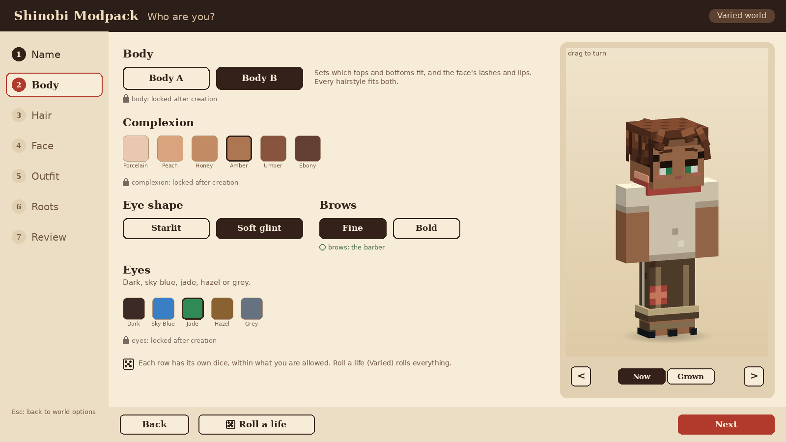

- **Body A or B** (VF's male and female): which tops and bottoms fit (the wardrobe's `gender`), the
  face's lashes and lips (Living Eyes' `feminine`), and VF's chemistry rules. Every hairstyle fits
  both bodies; the creator's opening looks prefer a style made for the body.
- **Complexion:** the six skin tones (`textures/body/0..5`), all open.
- **Eye shape:** starlit or soft glint (the Living Eyes styles). **Brows:** fine or bold.
- **Eye color:** Dark, Sky Blue, Jade, Hazel, Grey. No kekkei genkai eyes, and no clan's own colors.

### 3 Hair

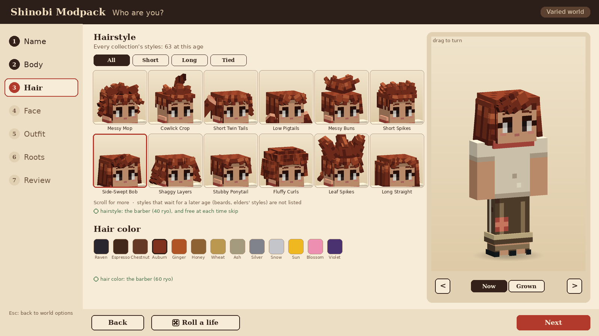

- **Hairstyles:** every collection's: the six shinobi collections' and the two civilian
  collections' (63 at the child stage). Clan hairstyles are the clans' looks and are not offered.
  Tabs (Short, Long, Tied) filter by the pieces' tags when the game has them.
- **Styles that wait:** balding and elders' styles open at the adult stage (`stage_hair`), on the
  Years Later mirror or at the barber.
- **Hair color:** Raven Black, Espresso, Chestnut, Auburn, Ginger, Honey Brown, Wheat Blonde, Ash
  Blonde, Silver Grey, Snow White, Sun Blond, Blossom Pink, Violet. Not offered: the colors a clan
  file defines, *Uchiha Black*, and *Hokage Gold* (a Hokage's fixed look).

### 4 Face

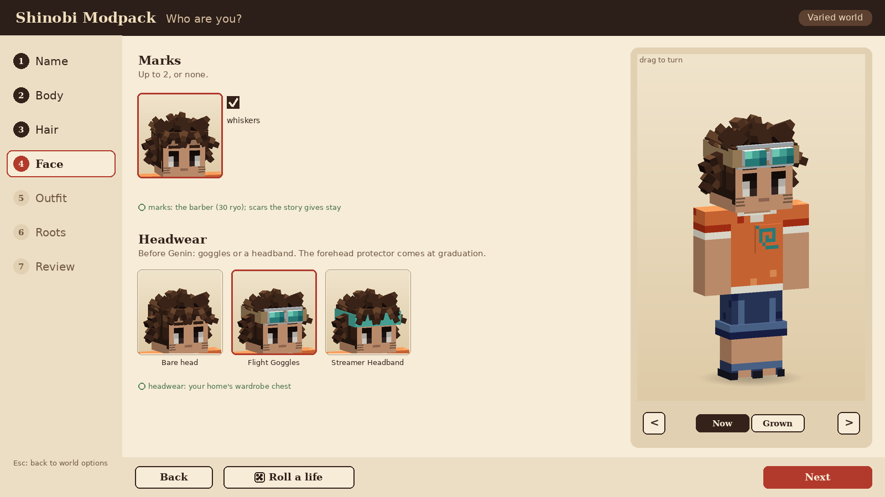

- **Marks, up to two:** today the open marks are the whisker marks (`whiskers`); clan marks and face
  paint are the clans'. More open marks (freckles, a small scar, a nose bandage) are asked of the
  wardrobe ([§14](#14-open-questions)).
- **Headwear, before Genin:** a bare head, flight goggles or a streamer headband. No forehead
  protector until graduation, and no masks.

### 5 Outfit

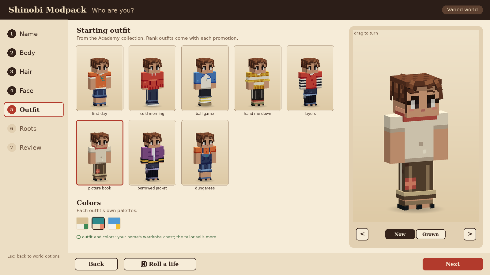

- **Outfits:** the Academy collection's Academy outfits: first day, cold morning, ball game, hand me
  down, layers, picture book, borrowed jacket, dungarees. Only outfits that fit your body are shown.
- **Colors:** each outfit's own palettes (three or four).
- Mixing a top with another outfit's bottom is not in the creator; the tailor sells variants later.

### 6 Roots

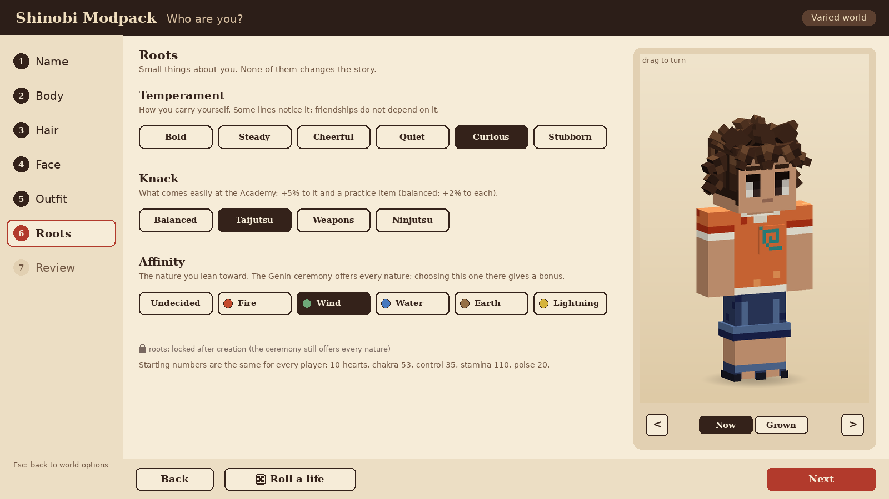

Small things about you. None of them changes the story, and none is a personality in the bond
system's sense: the bond system gives the player no personality (your chemistry with a resident is
the pair's seeded spark plus their warmth and openness, [BONDS.md §2](BONDS.md#2-the-meters)).

| Root | Options | Default | What it does |
|---|---|---|---|
| **Temperament** | bold, steady, cheerful, quiet, curious, stubborn | cheerful | A dialogue context tag (`player.temperament`): some lines notice how you carry yourself (the instructor's comments, a shopkeeper's aside). Never a gate, never a bond modifier |
| **Knack** | balanced, taijutsu, weapons, ninjutsu | balanced | Combat's starting leaning: +5% to that kind of fighting and one practice item to start with (the combat and items sessions own the numbers and ids). Balanced has neither |
| **Affinity** | undecided, fire, wind, water, earth, lightning | undecided | The nature you lean toward. The first nature is still chosen at the Genin ceremony (Ch 12), which offers every nature and shows your affinity as your leaning; choosing it there gives combat's bonus (+10% power with that nature). Undecided has no bonus and no leaning |

### 7 Review

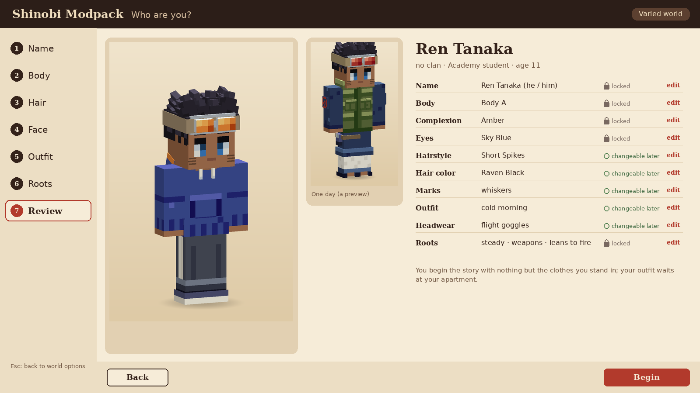

Your character large, a small *one day* adult preview, and every choice in a list with a lock or a
*changeable later* mark and an *edit* link back to its step. Below the preview, your starting key
item rests in an open hand: a small charred wooden charm, half of a matched pair, with the line
*The only thing that is yours.* (`starting_key_item`; the story session's item `half_charm`). Confirming sends the choice to the
server, which checks it against the same rules (`CreatorRules.validateCreation`); the client only
ever offers allowed choices, so a refusal means a mismatched pack. Then the prologue begins.

## 5. Who you are at the start

- **No clan.** You arrive in the village an orphan, the Hokage gives you an apartment and an
  Academy place, and a stipend pays your way (ROADMAP §1). The creator adds only what the screens
  ask: a name, a look and your roots. It asks nothing about parents, a hometown or a past, and it
  offers no background choices: the opening is the same for every player.
- **Even with everyone.** No clan starts warmer or cooler toward you. Your standing grows with the
  village, `group:clanless` and every clan by what you do ([BONDS.md §18](BONDS.md#18-village-scale)).
- **The clans are your neighbours.** Every clan line plays as the outsider's welcome test, which
  can end in a clan's invitation to join (`clan_status: clanless`;
  [SIDE_QUESTS.md §4](SIDE_QUESTS.md#4-clan-quest-lines)). From Genin you can learn one lesser
  technique from each clan where a friend reaches level 7 (`clan_friendship`).
- **Your own power** is not chosen here. Kindling Bond, the player's own ability, grows through your
  bonds and opens when the story says ([ROADMAP §11](ROADMAP.md#kindling-bond)); the creator shows
  nothing of it.
- **The clan power rule** (great clans stronger on average) applies to the village's residents, not
  to you: there is no clan to pick, so there is nothing to balance at creation.

## 6. Starting stats and kit

Every player starts with the same numbers; Roots add only small leanings. From the combat session
(final values in its `data/combat/resources.json`, branch `combat`):

| What | Start | Owner |
|---|---|---|
| Level, XP, rank | Level 1, 0 XP; Academy (floor 1) | Progression (`ranks.json`) |
| Hearts | 10 (20 HP; +1 heart every 6 levels) | Combat |
| Chakra | 53 (50 + 3 a level); the bar appears in Ch 3 | Combat |
| Chakra control | 35 of 100 (30 base, +5 for a player of no clan) | Combat |
| Stamina | 110 (100 base, +10 for a player of no clan) | Combat |
| Poise | 20 | Combat |
| Taijutsu | Academy basics | Combat |
| Knack | +5% to the chosen kind (combat), and its kit: `kit:knack.taijutsu` (`item:knuckle_wraps`), `kit:knack.weapons` (5 `item:practice_kunai` of fine grade), `kit:knack.ninjutsu` (`item:hand_sign_primer`); balanced has none | Combat, Items |
| Techniques, nature | None; Clone, Transformation and Substitution are learned in Beta 1; the first nature at the Genin ceremony | Combat |
| Key item, from the creator | `item:half_charm`: a small charred wooden charm, half of a matched pair; bound to the player, cannot be dropped, sold or stored away (given at the creator screen, in `kit:start`) | Story, Items |
| In the prologue | The charm and the prologue clothes | Items |
| At the apartment, Ch 1 (`kit:start`) | `item:apartment_key`, `item:futon`, `item:storage_chest`, `item:low_table`, `item:cupboard`, `item:cooking_pot`; the flat's built-in `wardrobe_cabinet` holds your chosen outfit as an `item:folded_outfit`; 100 ryo on day 1 (the first 30-ryo stipend and a 70-ryo welcome gift), then 30 ryo every morning | Items, Life |
| At enrolment, Ch 1 (`kit:academy`) | `item:enrolment_form`, `item:academy_textbook` | Items |
| From the instructor, Ch 2 | `item:practice_kunai` ×5, `item:practice_shuriken` ×10, `item:training_headband`, `item:ninja_sandals` | Items |
| At promotion | `kit:genin` (forehead protector, tool pouch, kunai, shuriken, ration bars, a Genin outfit); `kit:chunin` (flak vest, a Chunin outfit) | Items |

The kit ids are the items session's (`data/items/kits.json`). Your outfits live in the
`wardrobe_cabinet`, your flat's built-in closet: you change clothes there, and every outfit you
are given or buy goes into it as a folded outfit.

## 7. Locked and changeable

| Choice | After creation | Where | Cost |
|---|---|---|---|
| First name | Locked | — | — |
| Last name | Locked, until the **clan registry** in the Hokage Residence: founding a clan (from Chunin), or joining one by invitation or marriage, offers *take the clan's name, or keep yours* (`Names.atRegistry`). Nothing earlier changes it | The registry action (`found_clan`, joining) | — |
| Pronouns | Changeable | The settings screen | free |
| Body, complexion, eye shape, eye color | Locked | — | — |
| Brows | Changeable | Barber | free with a haircut |
| Hairstyle | Changeable | Barber; free on the Years Later mirror | 40 ryo |
| Hair color | Changeable | Barber | 60 ryo |
| Marks | Changeable (chosen marks; scars the story gives stay) | Barber | 30 ryo |
| Outfit and colors | Changeable: every outfit you own | Home's wardrobe cabinet; the tailor sells outfits by rank (100 Academy, 180 Genin, 320 Chunin, 480 Jonin), alterations 30, dye 20 | free |
| Headwear | Changeable; from Genin the forehead protector is one of them | Home's wardrobe cabinet | free |
| Temperament, knack, affinity | Locked (the Genin ceremony still offers every nature) | — | — |

Every restyle is checked against the creator's own lists for your current stage (`Restyle.apply`),
so the barber can never reach what the creator could not. **The barber** is a civilian shop
on the market street from Beta 1 (the items session's `service.restyle.*`, at these prices). Costs are data (`changes` in
`creator.json`), tuned with the economy.

## 8. Randomising

- **Dice on every row, in both modes:** each row (last name, complexion, eyes, hairstyle, hair
  color, marks, outfit, colors, headwear, each root) has a die that picks within what you are
  allowed. Row dice use the client's own randomness.
- **Roll a life, Varied only:** one button on every step rolls the whole character: the look from
  the residents' own weighted pools (common colors come up more often, the whisker marks 1 in 20),
  a last name, and the roots. It draws from the save seed's `creator` stream, so **the same seed
  always suggests the same character** (`creator.py --roll <seed>`). It never touches the first name
  or the pronouns. Classic offers no Roll a life: a curated world leaves the choosing to you.
- **Parity:** `LifeRoll` (Java) and `creator.py` (Python) roll the same numbers; the compiled file
  carries six seeds' rolls and the Java tests replay them.

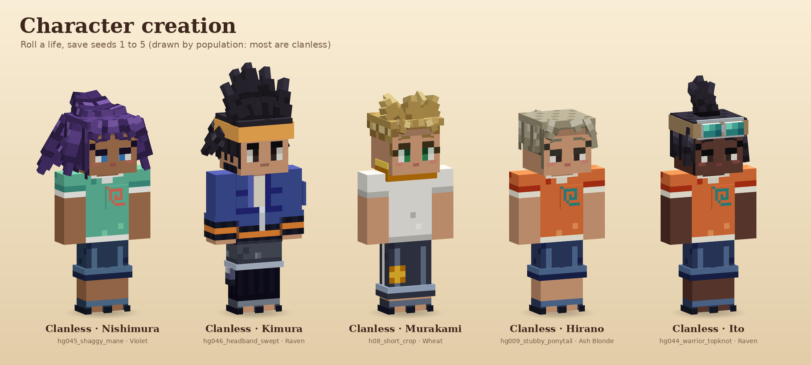
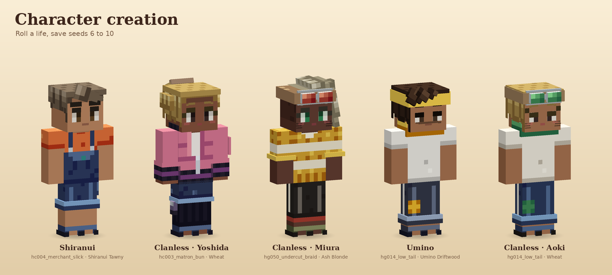
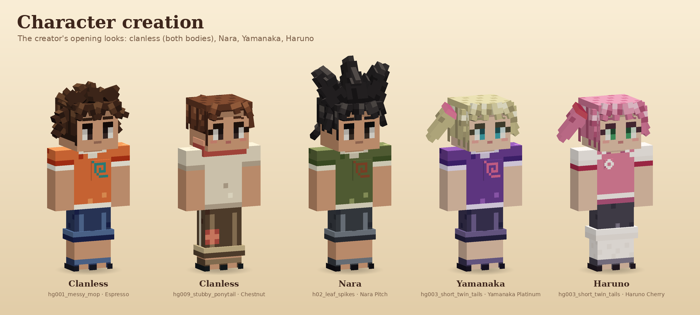

## 9. Age stages

The model is scaled, never swapped (ROADMAP §7, "Growing up"), so every piece fits every stage.

| Stage | Age | When | Scale | Head |
|---|---|---|---|---|
| Child | 11 to 12 | Creation, the whole beta | 0.78 (vanilla `scale`: hitbox, eye height 1.26, reach) | 1.1, drawn by the player poser |
| Teen | 13 to 17 | The first time skip, opening the Chunin arc (after the beta) | 0.9 | 1.0 |
| Adult | 18 and up | The second time skip, before the Jonin trial | 1.0, for good | 1.0 |

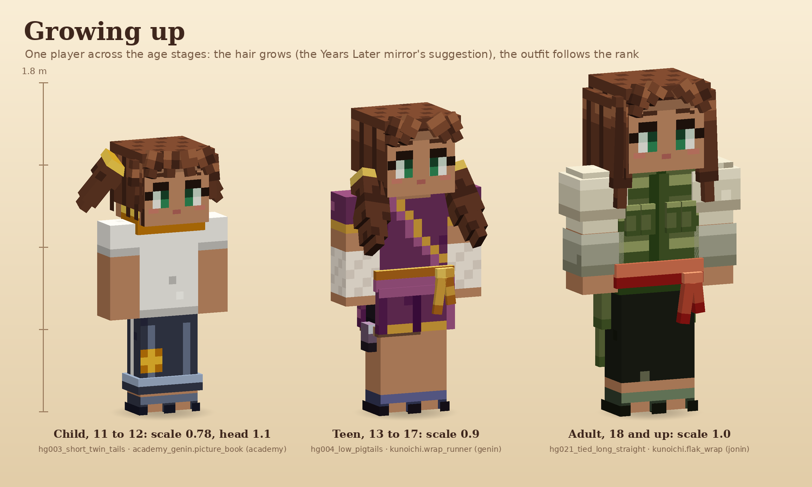

**How your choices carry across:**

- **Locked choices never change:** names, body, complexion, eye shape and color, roots.
- **Hair grows.** At each time skip the **Years Later mirror** opens: a free restyle of hair, hair
  color, brows, marks, outfit and headwear, from the new stage's lists. It preselects the style your
  hair grows into (`grows_into`: short twin tails become low pigtails, then a tied long sheet; a
  messy mop becomes shaggy layers) and you may pick again. Styles that waited for the stage open
  here.
- **Outfits follow the rank.** The child stage wears Academy outfits; a promotion gives the rank's
  outfit (Genin at graduation, Chunin in Beta 3, Jonin later) into the wardrobe cabinet, and at a time
  skip an outfit the new stage no longer offers becomes the stage's outfit for your rank, keeping
  your colors when it can (`GrowUp.grow`). Teens choose from 65 to 68 Genin and Chunin outfits,
  adults from 62 to 66 Chunin, Jonin, ANBU and Kage outfits, across the shinobi collections.
- **Headwear** gains every shinobi collection's pieces from the teen stage (21), forehead protectors
  among them; masks that cover the face come with the ANBU branch.

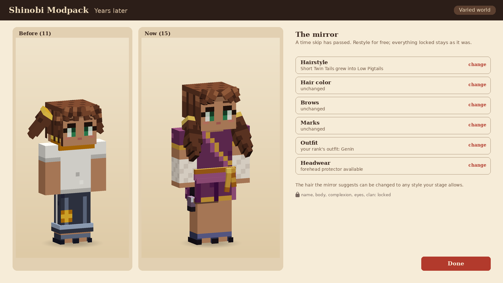

## 10. How residents address you

Text never contains your name. The creator fills these tokens (`Names.tokens`), next to ROADMAP's
`{name:<role>}`; the dialogue session's resolver reads them:

| Token | Is | Example |
|---|---|---|
| `{player}` | Your first name | Kaede |
| `{player_family}` | Your last name | Tanaka |
| `{player_full}` | First and last | Kaede Tanaka |
| `{player_clan}` | Your clan's name; empty while you have none, so lines that need it are skipped | (empty) |
| `{player_rank}` | Your title (dialogue's resolver, from your rank) | Academy student |
| `{they:player}`, `{them:player}`, `{their:player}` | Your pronouns, for lines about you | they, them, their |
| `{name:player}`, `{given:player}`, `{family:player}` | The role-token forms the story uses for every character, for you | Kaede Tanaka, Kaede, Tanaka |

A change of last name at the clan registry flows into every token at once.

Proposed for the dialogue session, which owns the pools: friends, classmates and the squad use
`{player}`; adults and shopkeepers `{player_family}` with a polite suffix, or *the Academy kid*;
the Hokage, papers and the journal `{player_full}`; strangers address you by rank. Dialogue reads
`clan_status` (`clanless` at the start; `born`, `member` and `other` are the condition's other
values), `rank_at_least` and `player.temperament`; no line depends on the spelling of a name.
There is no nickname option.

## 11. Data

**`tools/creator/creator.json` (authored)** holds only rules; every piece list is resolved from the
wardrobe, so a new Academy outfit or collection hairstyle appears in the creator with no edit here:

| Key | What |
|---|---|
| `creatable` | The origins the creator offers: for now `["clanless"]` |
| `pronouns`, `roots` | The pronoun options and the body's default; the Roots options and defaults |
| `stages` | Ages, scale, head scale and outfit ranks per stage |
| `name` | Length limits and the allowed characters |
| `bodies`, `complexions`, `eye_styles`, `brows`, `max_marks` | The fixed choices |
| `open` | What everyone may pick: every collection's hair, the open hair and eye colors and marks, the Academy collection's Academy outfits, the open headwear |
| `never_at_creation`, `reserved` | Ids no one picks (with the reason), and shared ids that belong to one clan |
| `stage_marks`, `stage_hair` | Marks and styles that wait for a later stage |
| `prologue_look`, `starting_key_item` | The prologue's clothes; the one key item shown on the review screen |
| `changes`, `time_skip_restyle` | Where each choice can change, and its cost |
| `grows_into` | The mirror's suggested grown styles |
| `default_overrides` | Opening looks that differ from the computed ones |
| `roll_open_mark_chance` | Roll a life's chance of an open mark |
| `clanless`, `clans` | Each origin's blurb, what it means, and for each clan its technique, kekkei genkai, quarter, starting headwear and locks (kept for [§12](#12-clan-born-play-a-later-option)) |

**The compiled file** (`data/narutominecraft/creator/creator.json`, about 370 KB) is what the game
loads: the creatable origins, pronouns and roots, one table of every outfit any origin may wear
(top, bottom, rank, palettes, the bodies it fits), the population weights of the creatable origins
for Roll a life, and per origin its hair, hair and eye colors, clan palettes, per-stage marks,
headwear and outfits, its opening looks per body and its Roll a life weights, then the six parity
rolls.

**`creator.py --check`** fails on: clans missing from or unknown to the wardrobe; open colors or
marks that belong to a clan or are also forbidden; unknown ids anywhere; a forehead protector or a
mask among starting headwear; a clan's colors, marks or hair reaching another origin; a forbidden id
at the child stage; an origin that cannot dress either body at some stage; incompatible outfit
pieces; a prologue look that does not fit both bodies; a blurb over 200 characters; roots or
pronoun defaults that are not options; an opening look or a parity roll the server's check would
refuse, or a roll of an origin the creator does not offer; a family name the story bible reserves
for its own characters (read from the bible, so it is written nowhere else); and a stale compiled
file.

## 12. Clan-born play: a later option

The user's decision for now: the player is born to no clan. The design keeps clan-born play ready to
return as an option, not deleted:

- **Data:** every clan's creator rules stay in `creator.json` and the compiled file: its hairstyles,
  colors, eyes and marks for its members, its Academy outfits and palettes, its starting headwear,
  its locks (the Hyuga's eyes), and a neutral blurb, quarter, technique and kekkei genkai for an
  origin screen. Turning it on is adding origins to `creatable` (and the origin step to the screen).
- **Rules already enforced** for every origin (`--check` and the tests): a clan's pieces reach only
  its members; kekkei genkai eyes are never picked (the Hyuga's are locked to them); marks a clan
  confers in the story and seals earned by mastery are never chosen; no protector before Genin.
- **What would come back with it:** an *Origin* step before *Name*, a clan-born last name fixed to
  the clan's, kin and warmer clan standing from day one, the clan technique and kekkei genkai from
  Genin, the clan line as a homecoming, and the balance work with combat (clan power tiers against
  advantages for players of no clan).

The clans as the data describes them:

| Origin | Standing | Who they are | Quarter | From Genin | Kekkei genkai | Welcome |
|---|---|---|---|---|---|---|
| **Senju** | noble | The founders' clan: calm, generous, with a long memory. A living tree grows through their hall. | A compound beside the Hokage Residence, under the Rock | Wood Release: short-lived wooden barriers and binding roots | Wood Release | Beta 2 |
| **Uzumaki** | noble | Few living members, a memorial shrine with the spiral crest, and the finest sealing tradition in the Leaf. Loud, warm, long-lived. | A small compound next to the Senju, mostly a memorial | Sealing chains and a deep chakra pool | — | Beta 2 |
| **Uchiha** | noble | Proud, private and quick to take offence; they run the Military Police from their walled quarter at the village edge. | A walled compound on the village's outskirts | The Sharingan's sight: earlier warnings, wider parries, techniques learned by watching | Sharingan | Beta 2 |
| **Hyuga** | noble | Formal and exact, split into a main house and a branch house. Every Hyuga has the pale eyes of the Byakugan. | A formal estate a short walk from the Residence | Byakugan and the Gentle Fist: sight through walls, strikes that drain chakra | Byakugan | Beta 2 |
| **Nara** | noble | Unhurried strategists who keep the deer forest at the village edge. Old allies of the Akimichi and the Yamanaka. | A plain compound against the clan's deer forest | Shadow Possession: your shadow holds a target to your movements | — | Beta 2 |
| **Akimichi** | noble | Big-hearted and proud of it; their table is always open. Old allies of the Nara and the Yamanaka. | A compound with a big kitchen hall, by the market street | Expansion and the Human Boulder | — | Beta 2 |
| **Yamanaka** | noble | Florists and sensors on the main street; the flower shop out front, a quiet hall behind. Old allies of the Nara and the Akimichi. | A compound on the main street, behind the flower shop | Mind Transfer (later tiers) and sensing | — | Beta 2 |
| **Inuzuka** | noble | Loud, loyal ninken handlers who live by the pack. Children get their first pup at the clan day. | Kennels and a clinic by the main gate | Fang over Fang, together with your ninken | — | Beta 2 |
| **Sarutobi** | noble | An old council family that carries the Will of Fire: warm, stubborn, fond of long scarves. | A family house near the Residence with a fire-training yard | Fire mastery and the clan staff | — | Beta 2.5 |
| **Aburame** | noble | Private, patient and precise; they share their bodies with the kikaichu insects and keep their faces behind lenses and collars. | A dark timber house with insect gardens | The insect swarm: it follows a target, drains chakra and marks it | — | Beta 2.5 |
| **Hatake** | noble | A house almost empty; everyone respects the name, few visit. Silver hair and ninken run in the family. | A lone, worn family house on a quiet lane | A ninken tracker and the chakra sabre | — | Beta 2.5 |
| **Kurama** | noble | A refined household of painters whose brushes make illusions. A polite rivalry with the Yuhi's school. | A house with a painting studio on the old artists' lane | Painted illusion: a genjutsu world closes over a target | — | Beta 2.5 |
| **Shimura** | noble | A stern, quiet council family that keeps to itself. Disagrees with the Sarutobi about everything. | A stern house close to the Hokage Rock | Vacuum blades and sealing | — | Beta 2.5 |
| **Yuhi** | noble | The genjutsu clan of crimson eyes and old trees; their grove is a training ground for illusions. | A house in a grove of old trees, in the garden district | Tree binding: the target sees itself bound while you step behind it | — | Beta 2.5 |
| **Gekko** | noble | A quiet family of swordsmen of the Crescent Moon: pale, tired-eyed, always with a blade at hand. | A kenjutsu dojo with a moon-viewing platform, by the training grounds | Dance of the Crescent Moon: two short-lived clones strike with you | — | Beta 2.5 |
| **Shiranui** | minor | Cool-headed senbon specialists of the Hokage's guard, easy smiles and all. | A family house near the gate barracks | — (an ordinary family) | — | Beta 2.5 |
| **Morino** | minor | Stern interrogators in long coats, and surprisingly gentle at home. | A severe house near the police HQ | — (an ordinary family) | — | Beta 2.5 |
| **Umino** | minor | The teachers' family: half the village was taught by an Umino. | Teachers' houses in the Academy streets | — (an ordinary family) | — | Beta 2.5 |
| **Haruno** | minor | A cheerful merchant household whose children became ninja. | A neat family house and garden on a residential street | — (an ordinary family) | — | Beta 2.5 |
| **Namiashi** | minor | Quiet swordsmen of the Hokage's guard, the wave-foot family. | A small footwork dojo near the training grounds | — (an ordinary family) | — | Beta 2.5 |
| **Hagane** | minor | Gate guards and messengers, with a metalworker's shop beside the forge. | A metalworker's shop on the market street | — (an ordinary family) | — | Beta 2.5 |
| **Kinoshita** | minor | The carpenters and builders who raised and rebuilt the Leaf's houses; the furniture is made in their yard. | The carpenters' and builders' yard | — (an ordinary family) | — | Beta 2.5 |
| **Tsuchigumo** | minor | A mountain shrine clan that lives in the Leaf but keeps its own counsel. | Stone houses by the quarry | Earth binding: earth-style ninjutsu and a web-like trap | — | Beta 2.5 |
| **Suzuran** | minor | Herbalists of the hospital gardens, with lily blood that shrugs off poison. | Herbalists' houses by the hospital | Herbalist: immune to poison, poultices and coatings at the workbench | — | Beta 2.5 |
| **Tobari** | minor | Silent scouts and night watchmen of the dark lanes behind the wall. | Shuttered houses behind the wall | Smothering: silence around you at night | — | Beta 2.5 |

## 13. Code, and what waits for Phase 0

**Built now:** `village/look`, a Minecraft-free Gradle module of the multi-project (java-library,
JUnit 5, release 25), the way `life/bonds` is built. The Village mod depends on it in Phase 0
(`implementation project(':village:look')`).

| Class | Does |
|---|---|
| `AgeStage` | The three stages: scale, head scale, eye height, the stage after N time skips |
| `Look` | The player's look, with the save's map form |
| `CreatorRules` | Reads the compiled file; the creatable origins; each origin's choices per stage; opening looks; Roots and pronouns; the server's `validateCreation` |
| `Names` | First-name rules, the last name (the pool or the `names` stream), the clan registry's rename, the tokens |
| `LifeRoll` | Roll a life (look and roots) on the `creator` stream, the same numbers as `creator.py` |
| `Restyle` | Venues (barber, home, settings, the mirror), costs, checked changes |
| `GrowUp` | Carrying a look into the next stage |
| `Seeds`, `Json` | The save seed's streams (the same as `life/bonds`; Core's `SaveSeed` later); a small JSON reader |

Tests (31): the stages agree with the compiled file; only the clanless can be created and no clan
hairstyle reaches the player; Roots and pronoun options and refusals; every opening look and every
Roll a life of 400 seeds passes the server's check; Java and Python rolls agree (look and roots);
clan pieces stay with their clan; the Byakugan is locked for the Hyuga and the Sharingan never
offered; conferred marks and elders' styles wait; no protector before Genin; names, tokens and the
registry's rename; the
barber, the home, the settings and the mirror; every opening look grows into an allowed teen and
adult look.

**Waits for Phase 0:**

- The **Shinobi tab** on the Create World screen and the save's mode and seed (Core).
- The **creator screen** (Village, client): the seven steps, the live preview with the player
  poser's head scale, the stage toggle, row dice and Roll a life, Minecraft widgets at every GUI
  scale; a network payload carrying the look, names, pronouns and roots to the server,
  `CreatorRules.validateCreation` on receipt, and the result on Core's player record.
- **Age-stage scaling** on the real player (the `scale` attribute and the poser's head), driven by
  `AgeStageChanged`.
- The **barber** (a VF-style shop at a map anchor), the **wardrobe cabinet** in furnish mode, the
  **Years Later mirror** after a `time_skip` action, the **prologue look** swap at Ch 1, the
  pronoun setting.
- Combat reading the knack and affinity; dialogue reading the tokens and `player.temperament`.
- Loading the compiled file through Minecraft's resource manager (the module's `CreatorRules` takes
  the parsed map).

## 14. Open questions

For the owner. Until answered, the current defaults stand, and each is one setting to change:
family names from the pool only; body labels *Body A* and *Body B*; whisker marks open to everyone;
Roll a life in Varied only.

1. **Roll a life in Classic.** Today Classic has row dice but no Roll a life. Should Classic have
   it too (still seeded)?
2. **Last name.** Only the 50 ordinary names are offered (picked or rolled). Should a player be able
   to type their own, checked against the clans' names?
3. **Bodies.** Two bodies, labelled A and B, as VF has. Is that right, or should the labels say boy
   and girl?
4. **Marks.** The only open mark is whiskers. Add a few more open marks (freckles, a small scar, a
   nose bandage) to the wardrobe?

Asked of the sibling sessions (owners decide):

- **Combat:** the knack's +5% and the affinity bonus at the ceremony, as ids in its data.
- **Dialogue:** the tokens and the address rules (§10), `player.temperament` as a context tag.
