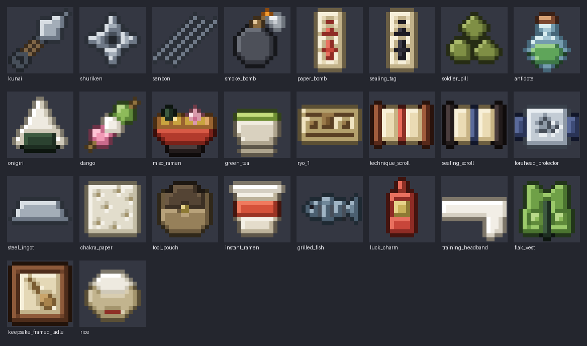

# Items, shops and crafting

Everything you can carry, buy, make, find or keep in the Shinobi Modpack, every shop in the Leaf, and the
ryo that moves between them. It goes with the buildings and blocks of the Konoha build (`tools/konoha/blocks.json`,
KONOHA_BUILD.md): every shop interior and crafting station here is a block asked of that catalogue.

**No spoilers here.** Story key items are generic types whose names come from their quest (section 1.6); nothing
in this file names a plot object.

| Piece | Where |
|---|---|
| The item registry: every item id in the pack | `tools/items/catalogue/*.tsv` → `data/items/items.json` |
| Every item, shelf and recipe in tables | [docs/items/CATALOGUE.md](docs/items/CATALOGUE.md) (generated) |
| Outfits (wardrobe outfits as items) | `tools/wardrobe/collections`, `clans` → `data/items/outfits.json` |
| Shops, stock, part-time jobs, services | `tools/items/shops.tsv`, `stock.tsv`, `jobs.tsv`, `services.tsv` → `data/items/shops.json` |
| Crafting stations and recipes | `tools/items/stations.tsv`, `recipes.tsv` → `data/items/recipes.json` |
| Loot tables: curios, salvage, drops, gathering, festival prizes | `tools/items/loot.tsv` → `data/items/loot.json` |
| Starting and rank kits | `tools/items/kits.tsv` → `data/items/kits.json` |
| Blocks asked of the Konoha session | `tools/items/blocks.tsv` + the catalogue → `data/items/block_requests.json` |
| Economy tuning (hand-edited) | `data/items/economy.json` |
| The economy in pure Java, with the beta's simulation | [`life/economy`](life/economy) (`dev.shinobi.life.economy`) |
| Prototype item sprites | `tools/items/sprites.py` → `docs/renders/items/` |

```
python tools/items/items.py             # compile the tables into data/items/ and docs/items/CATALOGUE.md
python tools/items/items.py --check     # validate everything and check the compiled files are current
python tools/items/items.py --stats     # counts, the art plan and what crafting saves
python tools/items/sprites.py [--check|--list]
./gradlew :life:economy:test            # 29 tests: prices, notes, stock, grades, data, the rules of thumb
./gradlew :life:economy:simulate        # the beta's ryo by day for three kinds of player (-Pseed=N, -Pdaily=typical)
```

## Contents

1. [The registry](#1-the-registry)
2. [Shops](#2-shops)
3. [Crafting](#3-crafting)
4. [The ryo economy](#4-the-ryo-economy)
5. [Item art](#5-item-art)
6. [Coordination](#6-coordination)
7. [What waits for Phase 0](#7-what-waits-for-phase-0)
8. [Open questions](#8-open-questions)

## 1. The registry

**558 entries: 527 new items and 31 existing ones given a price** (vanilla eggs and chests, VF's onion, bandage
and cooking pot), plus **410 outfits** as variants of one item. Every item id in the pack lives here; other
sessions key their data by these ids (combat stats, mission rewards, shopkeeper lines).

### 1.1 Ids and owners

- **Ids** are bare `snake_case`, unique pack-wide and never renamed (ROADMAP §5). Published to other systems as
  `item:<id>`. The in-game registry name is `<mod>:<id>`.
- **Which mod registers it** follows ROADMAP §4: tools, weapons and gear are Shinobi Combat's; key items are
  Progression's; the folded outfit is Village's; everything else (ryo, food, furniture, stations, materials,
  medicine, keepsakes, curios, pets) is Shinobi Life's. A row may override it (`mod=`).
- **Reused items** (`vanilla=` or `vf=` rows) register nothing; the row only gives a price and a place in shops.

### 1.2 Fields

Every row has: **id, name, category, group, rank** (the first rank that uses it), **slice** (the first slice that
needs it), **stack** (1, 3, 16 or 64), **price** (base ryo; 0 if never sold), **sources**, **use**, **gift tags**,
**art** and **props** (mechanics for the owning session: `food=`, `buff=`, `durability=`, `combat=`, `block=`,
`set=`, `sell=` ...). Shops, recipes, kits and loot tables add their own sources when compiled, so an item's
full list of ways to get it is in `items.json`.

| Category | Items | Beta 1 | Beta 2 | Beta 2.5 | Beta 3 | Later | What |
|---|---|---|---|---|---|---|---|
| tool | 19 | 6 | 8 |  |  | 5 | Thrown tools, bombs, tags, traps |
| weapon | 15 |  | 6 | 2 | 2 | 5 | Melee weapons, clan weapons |
| gear | 24 | 9 | 10 |  | 2 | 3 | Headwear, guards, vests, charms, camping |
| container | 6 |  | 4 |  |  | 2 | Pouches, holsters, the moving crate |
| consumable | 20 | 2 | 10 |  | 5 | 3 | Pills, medicine, coatings, wards, rations |
| food | 55 | 29 | 26 |  |  |  | Leaf dishes |
| ingredient | 47 | 41 | 6 |  |  |  | Kitchen ingredients the shops sell |
| scroll | 10 | 4 | 5 |  |  | 1 | Technique and storage scrolls, maps, books |
| material | 46 | 20 | 20 |  | 5 | 1 | Steel, paper, powder, ink, cloth, herbs, monster parts, loot |
| furniture | 82 | 60 | 17 |  |  | 5 | Furnish-mode pieces (their blocks are the Konoha session's) |
| station | 8 | 4 | 2 |  |  | 2 | Crafting stations for your home |
| keepsake | 61 | 4 | 34 | 17 |  | 6 | Display items: clans, filler arcs, side quests, missions, photographs |
| curio | 51 | 14 | 33 |  |  | 4 | Charming, useless loot |
| key | 73 | 13 | 49 |  | 3 | 8 | Quest, mission, exam and story items |
| gift | 18 | 14 | 4 |  |  |  | Bouquets, hairpins, novels, toys, tea tins |
| collectible | 8 | 5 | 3 |  |  |  | Info cards, clan crests, figurines, pressed flowers, masks |
| pet | 9 | 8 |  |  |  | 1 | Pet food, collars, toys |
| currency | 5 | 4 | 1 |  |  |  | Ryo notes, festival prize tokens |
| outfit | 1 | 1 |  |  |  |  | `folded_outfit`, plus 410 wardrobe outfits as its variants |
| **all** | **558** | **238** | **238** | **19** | **17** | **46** | |

The full list, item by item, is in [CATALOGUE.md](docs/items/CATALOGUE.md).

### 1.3 Highlights by family

- **Ninja tools and weapons.** Kunai in grades (practice, steel, rusty bandit salvage, chakra metal later; crafted
  kunai roll a quality grade on top), shuriken (practice, four-point, manji, windmill), senbon, caltrops, ninja
  wire, smoke, stink and flash bombs, sealing tags and paper bombs (chained bombs, barrier and suppression tags
  later); tanto, bokken, knuckle guards and wraps, weighted chain, bo staff, ninjato and katana (the kenjutsu
  route, Beta 3), kusarigama, iron mace, war fan, great battle fan and chakra blades later; four clan weapons
  (Sarutobi staff, Namiashi kokuto, Hagane mace, Hatake white sabre). Weapon stats are the combat session's,
  keyed by these ids.
- **Consumables.** Soldier, food and blood pills, chakra drops, herbal poultices, burn salve, antidotes, eye
  drops, VF's bandage, smelling salts and revival tonic, venom, numbing and sleep coatings for senbon, field
  rations, insect repellent and scent-masking powder for the Forest of Death, the bath house's hot towel.
- **Leaf dishes** (ROADMAP §7 Food): Ichiraku's ramen (shio, shoyu, miso, chashu, tonkotsu, the special, plus
  instant ramen at the grocer), onigiri (five fillings), bento, dango, tea and matcha, wagashi, the barbecue house's
  sets and squad feast, home cooking (miso soup, grilled fish, curry rice, katsudon, nikujaga, soba, oden,
  sukiyaki), festival food and New Year dishes. Each has VF hunger values, a VF Well Fed tier and a Leaf buff:
  ramen restores chakra, dango speeds chakra regen, barbecue raises taijutsu damage, tea holds off fatigue; every
  proper meal also halves fatigue's movement penalty for an hour.
- **Scrolls.** One `technique_scroll` item holds any technique (its variant is the combat session's technique
  id); storage scrolls seal a stack (nine stacks later); chakra paper for the nature ceremony; the Leaf map,
  a herb field guide and the smith's notebook unlock recipes.
- **Materials** for every station, salvage from bandit camps (scrap steel, broken blades, rusty kunai, purses,
  trinkets, stolen goods to return or sell), herbs from gathering spots and monster parts from the Forest of Death.
- **Gear.** The forehead protector (worn four ways as wardrobe styles), training headband, goggles, kasa,
  sandals and tabi boots, arm and shin guards, mesh undershirt, training weights, travel cloak, the flak vest, ANBU
  armour and mask and the Kage hat (later), pouches, bedroll and camp kit, and three shrine charms (luck, study,
  safety).
- **Furniture** (ROADMAP §7, "Your apartment and furniture"): beds, tables, cushions, tatami, screens, storage, lamps,
  plants, wall pieces, kitchen and bath pieces, a household shrine, training pieces, pet furniture, games, festival
  and balcony pieces, clan banners, screens and lanterns (one item each, a variant per clan), displays and the home
  stations. A furniture
  row names its block (`block=`) and the Konoha session's colour variants (`block_variants=`); one item sells any
  variant. The home session owns furniture's comfort, style and sets (docs/HOME.md); this registry owns the ids,
  prices and sources, and includes every piece of the home catalogue. The **first proper furniture set**
  (`set=starter`, the home session's Leaf set less the futon and low table the flat comes with: two floor cushions,
  tatami, an andon lamp, a scroll shelf, a shoji screen and the Leaf banner) costs 325 ryo: the economy is tuned so
  it takes about a week.
- **Keepsakes** (61): one per clan welcome (25), filler finale, several side and district quests, two per
  teammate's bond quests, the squad photograph, 20 from memorable missions, and milestone photographs. They place on one small display
  stand and are never sold.
- **Curios** (51): useless, charming things with a line of flavor (a counterfeit note with the Hokage upside down,
  a ronin's broken tsuba, a stone fox ear). The pawn shop buys them for a few ryo; nothing needs them. They drop
  from 18 curio tables (section 3.6).
- **Collectibles and gifts:** ninja info cards (famous figures from packs, foes you defeat and clients you meet on
  missions, backed by rank), clan crests, Hokage figurines, pressed flowers, festival masks and goldfish, fortunes;
  bouquets, hairpins, novels, sketchbooks, tea tins, toys, fireworks.
- **Ryo:** 1, 10, 100 and 1,000 ryo notes (ROADMAP §7).

### 1.4 Grades

Shop stock is always **standard**. Crafted tools, weapons, gear and medicine roll **standard, fine or
masterwork** (section 3.4). The grade is a data component on the stack, not a separate item.

| Grade | Durability | Damage (combat session) | Price factor (resale, special orders) |
|---|---|---|---|
| standard | ×1.0 | ×1.0 | ×1.0 |
| fine | ×1.5 | ×1.1 | ×1.6 |
| masterwork | ×2.0 | ×1.2 | ×2.5 |

Dishes keep VF's own "fine" (longer Well Fed, a better gift).

### 1.5 Outfits

Every outfit in the wardrobe's collections and clan files (410) is a variant of `folded_outfit`: buy it (or be
given it), put it in your wardrobe cabinet, and it is yours to change into for good. Prices by the outfit's rank:
Academy 100, civilian 120, Genin 180, Chunin 320, Jonin 480; ANBU and Kage outfits are given with the rank.
Collection outfits are sold at the tailor (four rotate each week, rank-gated); clan outfits only to the clan's
members (after joining one later, by invitation or marriage). Rank outfits come in the kits. The festival's yukata
are asked of the wardrobe owner (there are no festival outfits yet).

### 1.6 Key items and spoilers

Quest and story items are **generic types**: `quest_item`, `quest_letter`, `quest_parcel`, `quest_evidence` and
`lost_item`. A quest gives one with a name, look and text from its own keys in the dialogue bank, so this registry
never names a plot object and nothing here can spoil the story. Named key items are only the ones the roadmap
already names (the apartment key, the bell test's bell, the Forest of Death's pair of scrolls, mission scrolls and
reports, exam forms), the story session's starting key item (named by that session, with its text from the story),
and the missions session's 45 mission items (`mission_*`, bound to their mission).

### 1.7 Gift tags

The bond engine's personalities love and dislike gift ids (`life/bonds` `Personality`: `food:ramen`,
`item:scroll`, `item:brush` ...). The **gift** column says which tags an item meets; one tag can be met by many
items (every ramen is `food:ramen`; scrolls, blank scrolls and storage scrolls are `item:scroll`). The checker
fails if any gift a personality names is met by no item and is not a vanilla item.

### 1.8 Kits

What the story hands you (`kits.tsv`):

| Kit | When | Items |
|---|---|---|
| `kit:start` | the creator screen; Ch 1, the flat | the story's half charm (it cannot be dropped, sold or stored); apartment key, futon, low table, cupboard, chest, the built-in wardrobe, cooking pot; 100 ryo (the first stipend and a welcome gift) |
| `kit:knack.<knack>` | the creator screen | taijutsu: knuckle wraps; weapons: five fine-grade practice kunai; ninjutsu: a hand-sign primer (balanced: none; combat gives the knack's bonus) |
| `kit:academy` | Ch 1 to 2 | enrolment form, textbook, the Academy outfit from the creator, 5 practice kunai, 10 practice shuriken, training headband, sandals |
| `kit:genin` | Ch 7 to 9 | forehead protector, a Genin outfit, tool pouch, 3 kunai, 6 shuriken, 4 field rations |
| `kit:chunin` | Ch 20, if promoted | flak vest, a Chunin outfit |

The player starts clanless, so no kit holds clan gear.

## 2. Shops

### 2.1 How buying works

A shop is a keeper behind a **shop counter** (a Konoha block). Right-clicking the counter while the keeper is on
shift opens Shinobi Life's **shop screen**: the shop's shelf this week with prices, your ryo total, and buy, sell
(where the shop buys) and order buttons. Ryo are note items: paying takes notes largest first and gives change in
the fewest notes (`Ryo.Wallet`), so a purse never fills with ones. Village Friends' own villager trading stays
for residents' trades; shops use their own screen because stock, rank gates, slices, discounts and orders are
data, and vanilla trades cannot hold them.

**Price** (`Prices.buy`): `round(base × grade × the shop's markup × (1 − discount))`.

| Standing title (the shop's community or the village, the better) | Discount |
|---|---|
| Unwelcome | pays 20% more; a clan's own shop will not serve you |
| Newcomer | 0 |
| Helping Hand | 3% |
| Good Neighbor | 5% |
| Pillar of the Community | 8% |
| Hero | 12% |
| plus the keeper's friendship: level 5 / 8 | +2% / +3% |
| cap | 15% |

Titles and levels are the bond engine's (BONDS.md §8). Event stalls charge more (festival ×1.3, exam week ×1.2).

**Haggling** happens only where it is natural: Market Day stalls, festival and exam-week stalls, and the pawn
shop (where you haggle what it pays you). One try per item per visit: ask 10% off (55% base chance) or 20% (25%),
plus your standing (up to +20%), plus the keeper's warmth and minus their pride (their bond-engine trait axes). The
roll comes from the `haggle` stream keyed by shop, day and item, so reloading does not reroll it. A failed 20% ask
costs a little of the keeper's warmth.

**Selling.** Only furniture and stations sell back (half price, at the furniture shop or the pawn shop) and loot
and curios (at the pawn shop, for their pawn value). Nothing else turns into ryo (ROADMAP §7). The pawn shop pays
10% less for each repeat of the same item that day (never under a quarter) and has 400 ryo in its till a day.

**Stock.** Core lines are always on the shelf once your rank and the slice allow them. Each shop also has a few
**rotating slots** a week: a Classic save fills them from the rotating lines in order, a week at a time; a Varied
save rolls them from the `shops` stream keyed by shop and week (ROADMAP §5). Lines restock daily, every three
days, weekly, or once per save, each with its own quantity. A shop's display blocks show its current shelf.

**Special orders and services** (`services.tsv`): weapon commissions (a fine blade in three days, 2.2× with half
down) and repairs, custom outfits and alterations, custom furniture colours and fine pieces from the Kinoshita
yard, ordered technique scrolls (your natures', five days), bouquets delivered with a note, portraits, Ichiraku
catering for the squad, a barbecue house reservation, the bath, dojo lessons, the shrine's offering, pet adoption,
the barber's restyles.

### 2.2 The shops

31 shops (17 in Beta 1, 13 in Beta 2, 1 in Beta 3). Keepers and staff are roles bound to residents from map
markers; names are tokens. Hours follow VF routines (the keeper works open to close). Full stock lists are in
[CATALOGUE.md](docs/items/CATALOGUE.md#shops).

| Shop | District | Keeper | Hours | From | Sells | Discount by | Notes |
|---|---|---|---|---|---|---|---|
| `ichiraku` Ichiraku Ramen | main street | `role:shop.ichiraku.cook` | 11–23 | B1 | ramen, gyoza, tea | district | catering; job |
| `grocer` Market Grocer | market | `role:shop.grocer.keeper` | 7–19 | B1 | rice, onigiri, bento, ingredients | district | job |
| `fishmonger` Fish Stall | market | `role:shop.fishmonger.keeper` | 6–13, not Moonday | B1 | fish, fish cakes | district | |
| `dango_stand` Dango Stand | main street | `role:shop.dango.keeper` | 10–20 | B1 | dango, sweets, tea | district | |
| `tea_house` Willow Tea House | market | `role:shop.tea_house.owner` | 9–21 | B1 | tea, matcha, wagashi | district | job; the price war |
| `tea_house_rival` Lantern Tea House | market | `role:shop.tea_house_rival.owner` | 9–21 | B2 | tea, roasted tea, sweets | district | the price war |
| `barbecue_house` Barbecue House | market | `role:shop.barbecue.owner` | 11–22 | B2 | barbecue sets, the squad feast | clan:akimichi | reservation |
| `weapon_shop` Weapon Shop | market | `role:shop.weapon.smith` | 8–19 | B1 | blades, kunai, shuriken, guards | district | practice gear only until Genin; the forge (smithy station); repairs, commissions; the forge job |
| `tool_shop` Ninja Tool Shop | market | `role:shop.tools.keeper` | 8–20 | B2 | pouches, wire, bombs, tags, pills, camping | district | Genin+ |
| `scroll_shop` Scroll Shop | Academy streets | `role:shop.scrolls.keeper` | 9–18, not Moonday | B2 | technique scrolls, paper, ink, chakra paper | district | the public sealing desk; scroll orders |
| `flower_shop` Yamanaka Flowers | main street | `role:shop.flowers.keeper` | 8–19 | B1 | bouquets, ikebana, plants | clan:yamanaka | job |
| `furniture_shop` Furniture Shop | carpenters' lane | `role:shop.furniture.keeper` | 9–18, not Moonday | B1 | furniture, home stations, displays | district | showroom; buys furniture back; job |
| `kinoshita_yard` Kinoshita Yard | carpenters' lane | `role:clan.kinoshita.master` | 7–17, not Moonday | B2 | timber, lacquer, furniture plans, forge | clan:kinoshita | public workbench; job |
| `tailor` Tailor | market | `role:shop.tailor.keeper` | 9–18, not Moonday | B1 | outfits, cloth, dye | district | public tailor's table |
| `barber` Barber | market | `role:shop.barber.keeper` | 9–18, not Moonday | B1 | restyles, ribbons, hairpins | district | |
| `pawn_shop` Pawn Shop | market | `role:shop.pawn.keeper` | 10–20 | B2 | curios, second-hand goods | district | buys loot; haggles |
| `bath_house` Bath House | riverside | `role:shop.bath.keeper` | 15–24, not Moonday | B2 | baths, hot towels, onsen eggs | district | job |
| `pharmacy` Suzuran Pharmacy | hospital | `role:clan.suzuran.herbalist` | 8–20 | B2 | medicine, antidotes, herbs, coatings | clan:suzuran | public apothecary table; job |
| `hospital_dispensary` Hospital Dispensary | hospital | `role:medic.dispensary` | always | B1 | bandages, poultices | district | |
| `bookshop` Bookshop | Academy streets | `role:shop.books.keeper` | 9–19 | B2 | books, novels, maps, card packs | district | |
| `haruno_store` Haruno General Store | market | `role:clan.haruno.shopkeeper` | 8–19 | B1 | sundries, stationery, toys, novels, cards | clan:haruno | job |
| `academy_supply` Academy Supply Counter | Academy | `role:academy.supply_clerk` | 8–16, not Market Day | B1 | crafting supplies for students | district | Academy rank only; 20% off |
| `inuzuka_clinic` Inuzuka Clinic | gate | `role:clan.inuzuka.vet` | 7–19 | B1 | pet supplies | clan:inuzuka | ninken adoption |
| `cat_shelter` Cat Shelter | residential | `role:shop.shelter.keeper` | 9–17 | B1 | cat supplies | district | cat adoption |
| `hagane_metalworks` Hagane Metalworks | market | `role:clan.hagane.metalworker` | 8–18 | B2 | steel, wire, chain, powders | clan:hagane | |
| `shrine_office` Shrine Office | shrine | `role:shrine.priest` | 6–18 | B1 | charms, fortunes, wish plaques, incense | district | |
| `painters_studio` Painters' Studio | artists' lane | `role:clan.kurama.painter` | 10–18, not Moonday | B2 | paints, scrolls, screens | clan:kurama | portraits |
| `senbei_shop` Rice Cracker Shop | Uchiha quarter | `role:clan.uchiha.cracker_baker` | 9–18 | B2 | rice crackers, tea | clan:uchiha | |
| `market_day_stalls` Market Day Stalls | market | `role:merchant` | 7–15, Market Day | B1 | rotating rare goods | district | haggle |
| `festival_stalls` Leaf Festival Stalls | main street | `role:festival.stallholder` | 17–24, the festival | B2 | festival food, masks, games, fireworks | village | haggle; ×1.3 |
| `exam_stalls` Exam-Week Stalls | stadium streets | `role:exam.stallholder` | 8–22, the exams | B3 | snacks, pills, souvenirs | village | haggle; ×1.2 |

### 2.3 Part-time jobs

ROADMAP §7 pays 40 to 80 ryo a shift. One shift per workplace a day and two shifts a day at most; pay rises 10%
at 5, 15 and 30 shifts (capped at 80); keepers teach recipes and plans as you keep coming back.

| Job | From | Pay | Task | Teaches |
|---|---|---|---|---|
| `job.ichiraku` | Academy | 50 | Carry bowls in order through the evening rush | shio and shoyu ramen (3 shifts), miso ramen (8) |
| `job.grocer` | Academy | 45 | Stock to the list, two deliveries | 5% off at the grocer (5) |
| `job.flower_shop` | Academy | 40 | Water, then deliver bouquets that say the right thing | ikebana (4), Yamanaka standing (6) |
| `job.tea_house` | Academy | 45 | Serve tea to the right cushions | matcha and wagashi (5) |
| `job.haruno_store` | Academy | 40 | Sell, stock and bargain | 5% off at the store (5) |
| `job.furniture_shop` | Academy | 50 | Deliveries across the village | writing desk (4), step tansu (10) plans |
| `job.forge` | Genin | 70 | Bellows to the smith's colour, quench on time | kunai and shuriken (3), tanto and refined steel (6), the forge for your own crafts (10) |
| `job.bath_house` | Genin | 55 | Towels, the boiler's heat, a dry floor | free baths (5) |
| `job.kinoshita_yard` | Genin | 65 | Carry and plane timber | kotatsu (5), folding screen (10) plans |
| `job.pharmacy` | Genin | 60 | Sort and grind herbs | antidote (4), venom coating (8) |

### 2.4 Interiors (blocks asked of the Konoha session)

Each shop lists its interior blocks in `shops.tsv`; with the stations, the furniture blocks and the keepsake stand
they make **149 block requests** (`data/items/block_requests.json`): 81 furniture blocks, 37 interior pieces (the
shop counter and noren, Ichiraku's counter and stools, grills, stalls, the bath counter, the medicine-drawer wall,
the ema rack ...), 26 displays (one shared item-rendering block entity; this file sets their slots: shelves 6,
cubby walls 9, glass case 4, the curio shelf 12, the mannequin one outfit, the showroom plinth one furniture piece),
4 smithy and sealing stations, and VF's easel. The Konoha session adopted the first 119 (and the barber's chair,
the wall mount and eleven more noren); its colour variants (46 across 13 furniture pieces) and per-shop noren are
written into the rows. The 30 furniture pieces added from the home catalogue are new requests.

## 3. Crafting

### 3.1 Stations

ROADMAP §2 decided the workbench and the smithy; the rest earn their place below. Public stations stand in the
world and anyone may use them there; home stations are furniture.

| Station | Blocks | Public at | At home | From | Max grade | Why |
|---|---|---|---|---|---|---|
| Workbench | `workbench` | the Academy workshop, the Kinoshita yard | `workbench` (250) | B1 | fine | Tools from paper, powder and wire; pouches; furniture |
| Smithy | `forge`, `anvil`, `quench_trough`, `whetstone_wheel` | the weapon shop | `small_forge` (900, B2) | B2 | masterwork (home: fine) | Blades and thrown tools, smelting salvage, repair, upgrades |
| Kitchen | VF `cooking_pot`, `clay_oven`, `prep_table` | the flat, the Akimichi kitchen hall | VF's pot (in the flat) | B1 | VF fine | VF's stations with the Leaf's dishes as data recipes; no new kitchen block |
| Apothecary table | `apothecary_table` | the pharmacy, the hospital herb room | `apothecary_table` (450, B2) | B2 | fine | Medicine, antidotes, pills and coatings had nowhere to live; one table for the Suzuran line, the hospital night shift and Forest of Death supplies |
| Sealing desk | `calligraphy_desk` (public), `sealing_desk` (home) | the scroll shop | `sealing_desk` (600, later) | B2 | fine | Storage scrolls and blank scrolls in the beta; barrier and suppression tags from Chunin |
| Tailor's table | `tailor_table` | the tailor | `tailor_table` (400, later) | B1 | fine | Cloth gear, pet accessories, bandages, recolouring outfits: the outfit economy needs a place |

The apothecary table takes over the medicine and coatings ROADMAP first put on the workbench; the workbench keeps
paper bombs, smoke bombs, wire and tags as decided. Every screen follows VF's `StationMenu` pattern (a grid of six,
a recipe book, click to fill), with recipes as data.

### 3.2 Recipes

**121 recipes:** 27 at the workbench, 24 at the smithy, 41 at the kitchen stations (20 pot, 12 oven, 9 prep),
13 at the apothecary table, 10 at the tailor's table, 6 at the sealing desk; 50 in Beta 1, 56 in Beta 2, 6 in
Beta 3, 9 later. Kitchen recipes follow VF's rules (one item per slot, `x*2` is two slots, the vessel in its own
slot and returned) and become VF `hearth_recipe` data in Phase 0. Every other station takes up to six stacks.

Crafting saves 20 to 60% on what the shop charges (`--stats` lists each), and it can never print ryo: a crafted
piece that sells back (furniture) always sells for less than its inputs cost (the checker and `CatalogueTest`
enforce both).

### 3.3 Unlocks

A recipe is known once its station, rank and slice allow it, unless it names an unlock:

| Unlock | How | Example |
|---|---|---|
| `job:<job>:<n>` | n shifts at that part-time job | kunai after 3 forge shifts (ROADMAP: "the smith teaches you after a few jobs") |
| `blueprint` | a Furniture Plan of the piece (bought at the Kinoshita yard or taught by a job) | tansu chest, kotatsu |
| `book:<item>` | read the book | the smith's notebook (a side-quest reward) opens senbon and caltrops |
| `mentor:<role>` | the mentor teaches it | the smith's mesh shirt; later, masterwork blades |
| `clan:<clan>` | the clan teaches it once its welcome quest is done (the player is clanless; clans share with friends) | soldier pills (Suzuran), food pills (Akimichi), scent powder (Inuzuka) |
| `quest:<id>` | a quest's reward | grandmother's dish, the workbench plan |
| `card` | a VF recipe card from a friend | miso chashu ramen |

### 3.4 Quality grades

A craft rolls standard, fine or masterwork from the `crafts` stream (keyed by player, station and craft count, so
reloading never rerolls). **Mastery** at a station family rises at 5, 15, 35, 70 and 120 crafts. Fine chance =
5% + 8% per mastery level − 5% per difficulty + 15% with refined steel; masterwork needs mastery 3 and adds 4%
per level beyond it (+5% refined), at most 25%. Recipes of difficulty 0 (furniture, plain dishes) are always
standard; the small forge at home stops at fine. So a crafted blade can beat the shop's, as ROADMAP asks, and
the forge job and the smith's lessons are how you get there.

### 3.5 Repair and upgrade

Weapons and gear have durability (the combat session sets it per item; grades multiply it). A whetstone in the
field restores a quarter. The weapon shop repairs for `ceil(price × missing share × 0.3)` (masterwork ×1.5), or
sharpens a quarter for 5 ryo; at a forge you repair your own with steel (refined steel for fine and better).
Upgrades: commission a fine blade from the smith, or reforge your own standard piece at the weapon shop's forge
with refined steel once you have the mastery; masterwork needs the smith's mentoring and, later, chakra metal.

### 3.6 Where materials come from

You cannot break blocks (ROADMAP §7), so nothing is mined or chopped. Materials come from:

| Source | What | How |
|---|---|---|
| Shops | everything common: steel, wire, powder, paper, ink, cloth, timber, herbs, ingredients | Hagane Metalworks, the Academy supply counter, the Kinoshita yard, the pharmacy, the grocer, Haruno's |
| Missions | gifts from clients (a vegetable basket, steel, cloth, study notes), camp loot, monster parts | the missions session's tables name these items |
| Bandit camps | `salvage.bandit_camp`: scrap steel, broken blades, rusty kunai, blasting powder, purses, trinkets, stolen goods | refill weekly (ROADMAP §7 Levels) |
| Gathering spots | `gather.<spot>`: herbs, mushrooms, bamboo, fish, iron sand, feathers, the odd curio | right-click spots on a respawn timer, placed by the Konoha session: herb garden, forest floor, bamboo grove, river, river bend, cliff nest |
| The Forest of Death | `gather.forest_of_death` and the forest's beasts: ginseng, snake skin, centipede plates, tiger pelts, spider silk | Beta 3, during the exams |
| Enemies | `drop.<enemy>` and `curio.<kind>` | the combat session's enemy ids |
| Festivals | `festival.prize_stall`, `curio.festival` | festival games and prize tokens |

**Curio tables** (18): `curio.village`, `.academy`, `.market`, `.fields`, `.wilds`, `.river`, `.road`, `.shrine`,
`.far_lands`, `.bandit`, `.bandit_chief`, `.smuggler`, `.ronin`, `.foreign`, `.beast`, `.festival`, and later
`.covert` and `.battlefield`. Missions roll one on turn-in at grade B or better and on defeated enemies (the
missions session's chances); 34 loot tables in all.

## 4. The ryo economy

### 4.1 A closed loop

Ryo enter only through the stipend, pay and rewards, and leave only through shops and services; nothing converts
back except furniture (half price) and loot and curios at the pawn shop.

| Earn | Ryo | Spend | Ryo |
|---|---|---|---|
| **The orphan's stipend, every morning, all game** | 30 a day | Meals (Ichiraku, the grocer, tea, dango, barbecue) | 3 to 35 a dish; 25 to 40 a day typical |
| Part-time jobs | 40 to 80 a shift | Thrown tools, bombs and medicine used up | about 17 a D-rank, 115 a C-rank |
| D-rank missions (the missions session's bands; a steady player's median 105) | 60 to 150 | Soldier pills, coatings, scrolls of your nature | 60; 40; 150 to 600 |
| C-rank missions (median 445) | 300 to 600 | Furniture | 10 to 900 a piece |
| Story chapters with pay | 300 to 600 (provisional) | Outfits | 100 to 480 |
| Side quests (SIDE_QUESTS.md §2.6) | 10 to 400 | Gifts for friends | the bond engine's three a day |
| Small favours (generated) | 10 to 30 | Services: bath 8, lessons 50 to 60, repairs, orders, adoption 40 to 100, restyles 30 to 60 | |
| Pawning camp loot and curios | 1 to 30 each, 400 a day at most | Later: a house (30,000), a clan (20,000), estate halls; moving is free | |

**The stipend.** The owner decided: no rent, and the stipend keeps going. It stays **flat at 30 ryo a day for the
whole game**, not by rank: it covers a frugal day's meals and nothing more, so savings, tools, furniture and
everything you want still come from missions. A day of two D-ranks pays seven times the stipend.

### 4.2 Sinks and inflation guards

- **Sinks:** meals every day; thrown tools lost and medicine used on missions; tools lost on death; repairs;
  furniture; outfits and restyles; scrolls; gifts (friendship runs on them); services; charms and offerings;
  festivals; later, houses, clans and estate halls.
- **Guards:** prices never scale with your rank (new ranks open new, dearer goods instead); the Mission Desk offers
  two D-ranks a day; authored side-quest rewards pay once per save; generated favours pay little; job pay is capped
  and limited to two shifts a day; bandit camps refill weekly; the pawn shop's till and its falling price for
  repeats; no craft-and-sell loop; no interest.

### 4.3 The simulation

`life:economy`'s `EconomySim` plays the beta's 48 in-game days (Beta 1 days 1 to 12, Beta 2 13 to 36, Beta 3 37 to
48) for three players from `economy.json`: **frugal** (cheap meals, saves), **typical** (eats out at lunch, cooks
dinner, a pet, gifts every few days, keeps furnishing), and **spender** (eats out every meal, buys early). Each day:
income (stipend, shifts, board D-ranks from Ch 9, story and board C-ranks with their camp loot, side quests on the
day they open, favours), meals (at shop prices, or home-cooked at ingredient prices; onigiri when ryo run short),
upkeep (and a packed lunch on mission days), then the wishlist in order with a few days of food kept in reserve.
Seed 20261029:

| | Frugal | Typical | Spender |
|---|---|---|---|
| A day of two D-ranks leaves, after food, a packed lunch and upkeep | 61% | **59%** | 40% |
| First furniture set complete | day 6 | **day 6** (6 to 8 over seeds) | day 9 |
| Ryo at the end of Beta 1 / Beta 2 / Beta 3 | 611 / 4,971 / 5,880 | **269 / 2,510 / 2,495** | 105 / 676 / 471 |
| Earned over the beta | 10,612 | **9,948** | 9,018 |
| Spent | 4,732 | **7,453** | 8,547 |
| Hungry days | 0 | 0 | 0 |

(`./gradlew :life:economy:simulate` prints the full report, what each player bought and when, and `-Pdaily=typical`
the day-by-day ledger.) Over nine seeds `RuleOfThumbTest` holds ROADMAP's rules of thumb and the guards:

- **A day of D-ranks covers food and leaves about half:** the typical Genin keeps 40 to 60% (59%).
- **The first proper furniture set takes about an in-game week:** the typical player's median day is 6 to 9.
- **Nobody starves or goes into debt**, and every ryo is accounted for.
- **The stipend never replaces missions:** it does not feed a typical Genin, and missions earn more than 2.5 times
  the stipend over the beta, Academy days included.
- **Ryo do not pile up:** the typical player ends the beta with 300 to 2,500 ryo and spends at least 70% of what
  it earns; frugal ends richer than typical, typical than the spender.

Mission pay in the simulation is the missions session's: its bands and a steady player's medians (D 105, C 445).
Chapter pay (300 to 600 for the four story chapters that pay) is provisional and marked in `economy.json`.

## 5. Item art

What each item needs (`art` column; `items.py --stats`), for all items and for the beta:

| Kind | All | Beta | Status |
|---|---|---|---|
| Authored 16px sprite | 27 | 27 | **26 prototypes done** (`sprites.py`) |
| Palette variant of an authored sprite (`tint:`) | 46 | 39 | **26 done** |
| Simple 16px icon still to draw | 345 | 325 | to do: mostly food, ingredients, materials, curios and key items, in the prototypes' style |
| 3D held model | 16 | 9 | to do: tanto, bokken, bo staff, weighted chain, ninjato, katana, the clan weapons; later weapons |
| Block (furniture, stations, displays) | 85 | 77 | the Konoha session's models; the item icon is the block |
| From the wardrobe | 7 + 410 outfits | 4 + 282 | icons rendered from the wardrobe's own renders |
| Reused (vanilla or VF) | 32 | 31 | nothing to draw |

The prototypes are programs, not pixel strings: each shape is rasterised on the 16 × 16 grid and shaded like VF's
`tools/item_sprites.py` and vanilla items (light from the top left, three tones, a dark outline), so a palette
swap is one line. Previews: [sprites](docs/renders/items/sprites.png), [palette variants](docs/renders/items/tints.png),
16px originals in `docs/renders/items/16px/`.



## 6. Coordination

| Session | What passed between us |
|---|---|
| Konoha build | 119 block requests (furniture, interiors, displays, stations) adopted into `tools/konoha/blocks.json`; renames `tatami` and vanilla `potted_fern`; colour and noren variants written into the rows; new: `wall_mount`, `barber_chair`, the barber's site, eleven more shop noren; slot counts for displays; gathering-spot anchors |
| Combat | Weapon, tool, coating and gear ids reconciled (combat keys stats by these ids; grade multipliers agreed); clan weapons are clan-line rewards now that the player is clanless; enemy ids for `drop.*` tables to confirm |
| Missions | 18 curio tables under its names, 45 `mission_*` items (9 more reuse existing ids), 20 mission keepsakes, client gifts mapped to items, info cards, technique scrolls by pool; pay bands used in the simulation, means to confirm |
| Home | No collection book: curios, keepsakes, cards and crests are ordinary items kept in chests and on display furniture (display case, wall mount, curio cabinet, shelves); its furniture catalogue merged into the registry (new pieces keep its ids and prices; duplicates map to the ids the Konoha blocks use); the starter set is its Leaf set; the stipend; the house price and the spare key are its numbers (moving is free) |
| Character creation | The starting, knack and rank kits; the story's starting key item; restyle prices at the barber |
| Dialogue | Shop ids, keeper roles and districts for `dlg:shop.<shop>.*` pools, plus haggle, order and job lines |
| Roadmap and side quests | The stipend; this file's summary in ROADMAP §7; SIDE_QUESTS.md §8's rewards used as written |
| Bonds | Gift tags meet every gift a personality names; standing titles and keeper friendship set discounts |

## 7. What waits for Phase 0

Phase 0 builds the mods; until then everything here is data, design, Python tools and the pure-Java economy.

- **Shinobi Life:** register its items and the item components (grade, durability, technique, outfit, variant);
  the shop screen on the shop counter, with the wallet and change; loading `shops.json`, `recipes.json`,
  `loot.json` and `economy.json` through codecs (`life:economy` keeps the rules; it reads JSON only for its tests
  and simulation); station blocks and screens on VF's `StationMenu` pattern; turning the cooking recipes into VF
  `hearth_recipe` data; the pawn shop and haggling dialogue; gathering spots; the ryo HUD.
- **Shinobi Combat:** registering tools and weapons with the combat session's stats; grades as multipliers.
- **Shinobi Progression:** mission and key items, kits given by quests, loot rolls on turn-in.
- **Shinobi Village:** `folded_outfit` and the wardrobe cabinet's screen.
- **VF:** the currency API ROADMAP §4 already plans.
- **Art:** copying the 16px sprites into the mods' textures; drawing the icons and models.

## 8. Open questions

For the owner:

1. **Yukata at the festival.** The festival stalls sell yukata outfits, but the wardrobe has none; should the
   wardrobe owner add a few festival outfits, or should the stalls skip outfits?
2. **The stipend's size.** It is flat at 30 a day for the whole game. Should it instead grow a little with rank
   (for example 30 at the Academy, 40 at Genin, 50 at Chunin), or stay flat as now?
3. **Haggling.** Only at stalls and the pawn shop; should regular shops haggle too (at a lower chance)?
