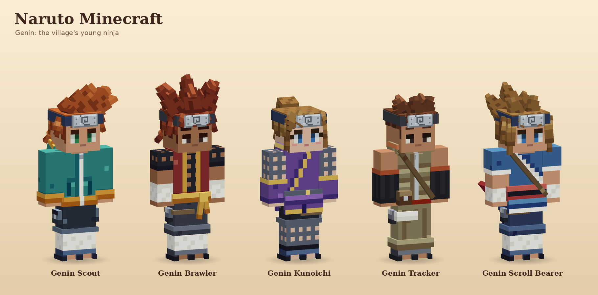
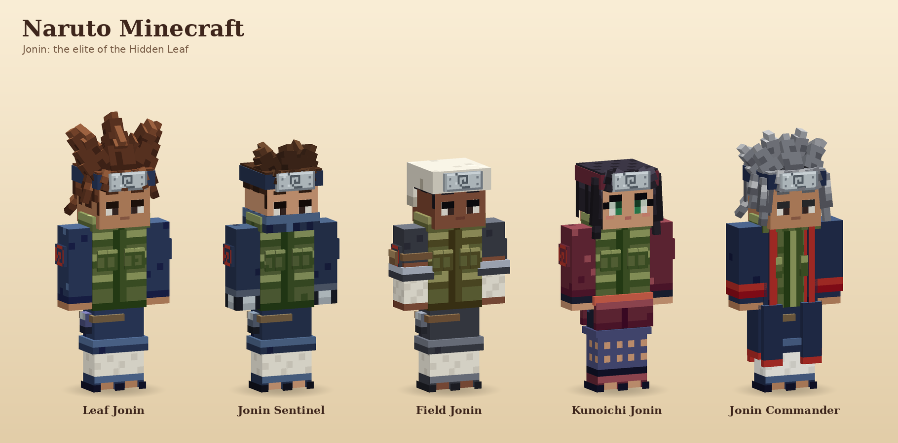
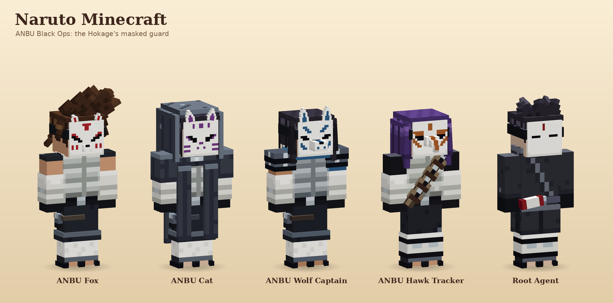

# Naruto Minecraft

A Naruto-themed Minecraft mod built on the resident model from Village Friends: the player mesh with its overlay layers, the six skin complexions, the Living Eyes face and the palette-locked wardrobe of textured 3D pieces. This first stage is only about the look of the characters. It has no Java, entities or gameplay yet.

## The village

The mod's goal is a living Hidden Leaf: you start as a ninja and work your way up to Hokage. Every character is dressed for one rank on that ladder, and the NPCs of each rank share a look so you can read someone's rank at a glance:

**Academy → Genin → Chunin → Jonin → ANBU → Hokage**

Each character JSON sets `rank`. The role outfits are the village's general population. A few looks that echo characters from the show are marked `"signature": true` and kept apart in `lineup.png`.

### Genin: the village's young ninja



| Character | Hair | Headwear | Top | Bottom | Palette |
|---|---|---|---|---|---|
| Genin Scout | Swept Spikes (ginger) | Forehead Protector | Scout Hoodie | Cargo Shorts | Genin Scout |
| Genin Brawler | Leaf Spikes (auburn), bold brows | Forehead Protector | Brawler Vest (chain mesh, sash, bandaged fists) | Shinobi Trousers | Brawler |
| Genin Kunoichi | High Ponytail (honey), swings | Forehead Protector | Kunoichi Tunic | Mesh Leggings | Kunoichi Violet |
| Genin Tracker | Short Crop (chestnut) | Forehead Protector | Tracker Zip Vest (satchel) | Genin Track Pants | Genin Tracker |
| Genin Scroll Bearer | Uchiha Spikes (honey) | Forehead Protector | Scroll Bearer (wrap top, obi, summoning scroll) | Shinobi Trousers | Scroll Bearer |

### Jonin: the elite of the Hidden Leaf



| Character | Hair | Headwear | Top | Bottom | Palette |
|---|---|---|---|---|---|
| Leaf Jonin | Leaf Spikes (chestnut) | Forehead Protector | Konoha Flak Vest | Shinobi Trousers | Konoha Jonin |
| Jonin Sentinel | Short Crop (espresso) | Masked Protector (cloth face mask) | Sentinel Vest (plated gloves, tanto) | Shinobi Trousers | Jonin Sentinel |
| Field Jonin | Short Crop (raven) | Bandana Protector | Field Vest (rolled sleeves, bandages) | Shinobi Trousers | Jonin Field |
| Kunoichi Jonin | Low Ponytail (raven) | Forehead Protector | Kunoichi Jonin (sash, wrap skirt) | Mesh Leggings | Jonin Kunoichi |
| Jonin Commander | Kage Spikes (silver) | Forehead Protector | Commander Coat (leaf crest on the back) | Shinobi Trousers | Jonin Commander |

### ANBU Black Ops: the Hokage's masked guard



| Character | Hair | Headwear | Top | Bottom | Palette |
|---|---|---|---|---|---|
| ANBU Fox | Swept Spikes (espresso) | ANBU Fox Mask | ANBU Armor | Shinobi Trousers | ANBU |
| ANBU Cat | Long Straight (raven) | Cat Mask and Hood | ANBU Cloak | Shinobi Trousers | ANBU Shadow |
| ANBU Wolf Captain | Low Ponytail (raven) | Wolf Mask | ANBU Captain (pauldrons, scarf, ninjato) | Shinobi Trousers | ANBU Wolf |
| ANBU Hawk Tracker | Long Straight (violet) | Hawk Mask | ANBU Tracker (kunai bandolier) | ANBU Greaves | ANBU Hawk |
| Root Agent | Short Crop (raven) | Root Mask | Root Tunic (ink scroll, tanto) | ANBU Greaves | ANBU Root |

### Kage and signature looks


| Character | Rank | Eyes | Hair | Headwear | Top | Bottom |
|---|---|---|---|---|---|---|
| Hokage | kage | Starlit, sky blue | Kage Spikes (gold) | Kage Hat | Hokage Haori | Shinobi Trousers |
| Uchiha | genin | Starlit, Sharingan (glows) | Uchiha Spikes (blue-black) | Forehead Protector | Uchiha High Collar | Uchiha Shorts |
| Leaf Genin | genin | Starlit, sky blue, whisker marks | Leaf Spikes (sun blond) | Forehead Protector | Genin Track Jacket | Genin Track Pants |
| Kunoichi | genin | Starlit, jade, feminine | Long Straight (blossom pink) | Forehead Protector | Kunoichi Qipao | Kunoichi Shorts |
| Hyuga | genin | Starlit, Byakugan | Low Ponytail (espresso) | Forehead Protector | Hyuga Robe | Shinobi Trousers |
| Green Beast | genin | Soft Glint, dark, bold brows | Bowl Cut (raven) | none | Green Jumpsuit | Green Leggings |

Each character has a sheet in `docs/renders/`, with front, side, back, mid-stride and close-up views. Academy and Chunin outfits are still to come.

## How the pieces work

The Village Friends wardrobe engine is kept in `tools/wardrobe/` and extended:

- **Kinds:** besides hair, tops and bottoms there are **faces** (painted on the head, plus optional decal pieces) and **headwear** (hats and headbands over the hair). A headwear module can hide hair pieces by id prefix (`hides_hair`), so the kage hat hides the crown spikes but keeps the bangs. Headwear with `covers_face` (the ANBU mask) hides the whole Living Eyes face, and a character may wear no headwear at all.
- **Shared kit:** `kit_shinobi.py` holds the gear every rank reuses: `forehead_protector(g, band, ring=)` (the band, the steel plate, the knot and two swaying tails; `ring=False` drops the band for headwear that brings its own, like the bandana), `flak_vest`, `mesh` (a dark chain-mesh net with the skin showing through) and `tanto`, on top of the Village Friends `kit.py` helpers (`belt`, `collar`, `roll`). `masks.py` builds every ANBU mask from the same parts: a 16 x 15 porcelain `plate` at double resolution, a `strap`, and raised `ears`, `bump` (snouts, brows) and `beak` pieces.
- **Cloth masks:** headwear with `covers_mouth` (the Sentinel's face mask) keeps the eyes and brows but hides the lips, and may place pieces over the lower face. Validation still rejects any headwear piece that would cover the eyes.
- **Living Eyes:** the face is the Village Friends one (`FaceDetails` and `ResidentModel`), ported in `tools/wardrobe/living_eyes.py`. Lashes, the tinted upper white, pupil, glint, iris, brows, mouth and neck shade are thin planes in front of the face, finer than a skin pixel, so they can blink and glance in game. Each character picks `eye_style` (`starlit`, three rows tall, or `soft_glint`, two rows, lower) and `feminine` (adds the lash wing, arched brows, rosy lips and blush). Brow and lash colors come from the hair, lid, lip and blush colors from the complexion. Two additions to Village Friends: `"brows": "bold"` draws a thick, full-pixel brow, and `"marks": ["whiskers"]` adds three thin cheek marks on each side.
- **Eye colors:** the `E` key role resolves through `eye_colors.json` (Dark, Sky Blue, Jade, Sharingan, Byakugan), the way `H` resolves through hair colors. The face piece paints only the eye row the planes sample. An eye color with a `pattern` (rows of shades 0-4, twice as tall as wide) replaces the pupil and iris with one high-resolution decal, and `glow` draws it fullbright: that is the Sharingan, with its pupil and three tomoe, and the pupil-less pale Byakugan.
- **Decals:** small pieces drawn at 2x, 3x or 6x resolution through the piece `scale`: the 火 panel and back kanji, the swirls, the leaf plate, the Uchiha fan, the Kunoichi's white circle and the ANBU mask.
- **Palettes:** every Naruto palette keeps the same meaning per role, so pieces mix: `S` is white cloth and bandages, `A` red, `L` tan leather, `M` steel, `K` dark navy, `D` navy cloth. `P` is the character's main color: flak green for Hokage and Konoha Jonin, dark navy for Uchiha, orange for the Genin, red for the Kunoichi, armor grey for ANBU, off-white for Hyuga and bright green for the Green Beast. Where a palette needs another color the role keeps its job and changes hue: ANBU's `D` cloth is near-black, Hyuga's `A` trim is lavender and the Green Beast's `L` is the orange of the leg warmers.
- **Characters:** `tools/wardrobe/characters/*.json` dresses each character with one piece of each kind, a palette, hair and eye colors and a complexion.

```text
python tools/wardrobe/wardrobe.py            # compile every piece to src/main/resources/assets/narutominecraft/wardrobe/
python tools/wardrobe/wardrobe.py --check    # validate and confirm the outputs are current
python tools/wardrobe/render.py --all        # render every character sheet, the signature line-up and one line-up per rank
python tools/wardrobe/render.py uchiha       # one sheet
```

The tools need Python 3 with Pillow and NumPy. The renders come from an offline renderer that uses the exact Minecraft geometry and box-UV mapping. They are not in-game screenshots. Faces are lit the way Minecraft lights entities, from the direction each face points: tops brightest, fronts and backs a little darker, sides darker again. Never hand-edit the compiled PNG and JSON files.
