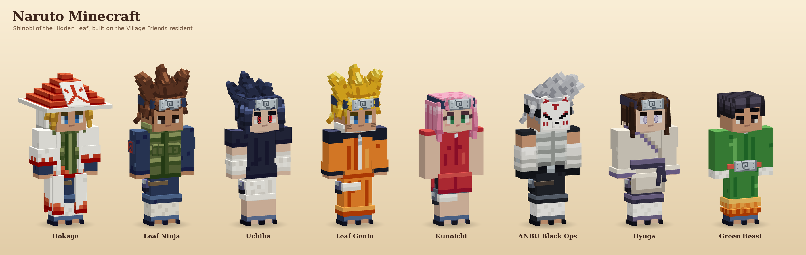

# Naruto Minecraft

A Naruto-themed Minecraft mod built on the resident model from Village Friends: the player mesh with its overlay layers, the six skin complexions, the Living Eyes face and the palette-locked wardrobe of textured 3D pieces. This first stage is only about the look of the characters. It has no Java, entities or gameplay yet.



## Characters

| Character | Eyes | Hair | Headwear | Top | Bottom | Palette |
|---|---|---|---|---|---|---|
| Hokage | Starlit eyes, sky blue | Kage Spikes (gold) | Kage Hat | Hokage Haori | Shinobi Trousers | Hokage |
| Leaf Ninja | Soft Glint eyes, dark | Leaf Spikes (chestnut) | Forehead Protector | Konoha Flak Vest | Shinobi Trousers | Konoha Jonin |
| Uchiha | Starlit eyes, Sharingan (glows) | Uchiha Spikes (blue-black) | Forehead Protector | Uchiha High Collar | Uchiha Shorts | Uchiha |
| Leaf Genin | Starlit eyes, sky blue, whisker marks | Leaf Spikes (sun blond) | Forehead Protector | Genin Track Jacket | Genin Track Pants | Leaf Genin |
| Kunoichi | Starlit eyes, jade, feminine | Long Straight (blossom pink) | Forehead Protector | Kunoichi Qipao | Kunoichi Shorts | Kunoichi |
| ANBU Black Ops | Hidden by the mask | Swept Spikes (snow) | ANBU Mask | ANBU Armor | Shinobi Trousers | ANBU |
| Hyuga | Starlit eyes, Byakugan | Low Ponytail (espresso) | Forehead Protector | Hyuga Robe | Shinobi Trousers | Hyuga |
| Green Beast | Soft Glint eyes, dark, bold brows | Bowl Cut (raven) | none | Green Jumpsuit | Green Leggings | Green Beast |

Each character has a sheet in `docs/renders/`, with front, side, back, mid-stride and close-up views.

## How the pieces work

The Village Friends wardrobe engine is kept in `tools/wardrobe/` and extended:

- **Kinds:** besides hair, tops and bottoms there are **faces** (painted on the head, plus optional decal pieces) and **headwear** (hats and headbands over the hair). A headwear module can hide hair pieces by id prefix (`hides_hair`), so the kage hat hides the crown spikes but keeps the bangs. Headwear with `covers_face` (the ANBU mask) hides the whole Living Eyes face, and a character may wear no headwear at all.
- **Living Eyes:** the face is the Village Friends one (`FaceDetails` and `ResidentModel`), ported in `tools/wardrobe/living_eyes.py`. Lashes, the tinted upper white, pupil, glint, iris, brows, mouth and neck shade are thin planes in front of the face, finer than a skin pixel, so they can blink and glance in game. Each character picks `eye_style` (`starlit`, three rows tall, or `soft_glint`, two rows, lower) and `feminine` (adds the lash wing, arched brows, rosy lips and blush). Brow and lash colors come from the hair, lid, lip and blush colors from the complexion. Two additions to Village Friends: `"brows": "bold"` draws a thick, full-pixel brow, and `"marks": ["whiskers"]` adds three thin cheek marks on each side.
- **Eye colors:** the `E` key role resolves through `eye_colors.json` (Dark, Sky Blue, Jade, Sharingan, Byakugan), the way `H` resolves through hair colors. The face piece paints only the eye row the planes sample. An eye color with a `pattern` (rows of shades 0-4, twice as tall as wide) replaces the pupil and iris with one high-resolution decal, and `glow` draws it fullbright: that is the Sharingan, with its pupil and three tomoe, and the pupil-less pale Byakugan.
- **Decals:** small pieces drawn at 2x, 3x or 6x resolution through the piece `scale`: the 火 panel and back kanji, the swirls, the leaf plate, the Uchiha fan, the Kunoichi's white circle and the ANBU mask.
- **Palettes:** every Naruto palette keeps the same meaning per role, so pieces mix: `S` is white cloth and bandages, `A` red, `L` tan leather, `M` steel, `K` dark navy, `D` navy cloth. `P` is the character's main color: flak green for Hokage and Konoha Jonin, dark navy for Uchiha, orange for the Genin, red for the Kunoichi, armor grey for ANBU, off-white for Hyuga and bright green for the Green Beast. Where a palette needs another color the role keeps its job and changes hue: ANBU's `D` cloth is near-black, Hyuga's `A` trim is lavender and the Green Beast's `L` is the orange of the leg warmers.
- **Characters:** `tools/wardrobe/characters/*.json` dresses each character with one piece of each kind, a palette, hair and eye colors and a complexion.

```text
python tools/wardrobe/wardrobe.py            # compile every piece to src/main/resources/assets/narutominecraft/wardrobe/
python tools/wardrobe/wardrobe.py --check    # validate and confirm the outputs are current
python tools/wardrobe/render.py --all        # render every character sheet and the line-up
python tools/wardrobe/render.py uchiha       # one sheet
```

The tools need Python 3 with Pillow and NumPy. The renders come from an offline renderer that uses the exact Minecraft geometry and box-UV mapping. They are not in-game screenshots. Faces are lit the way Minecraft lights entities, from the direction each face points: tops brightest, fronts and backs a little darker, sides darker again. Never hand-edit the compiled PNG and JSON files.
