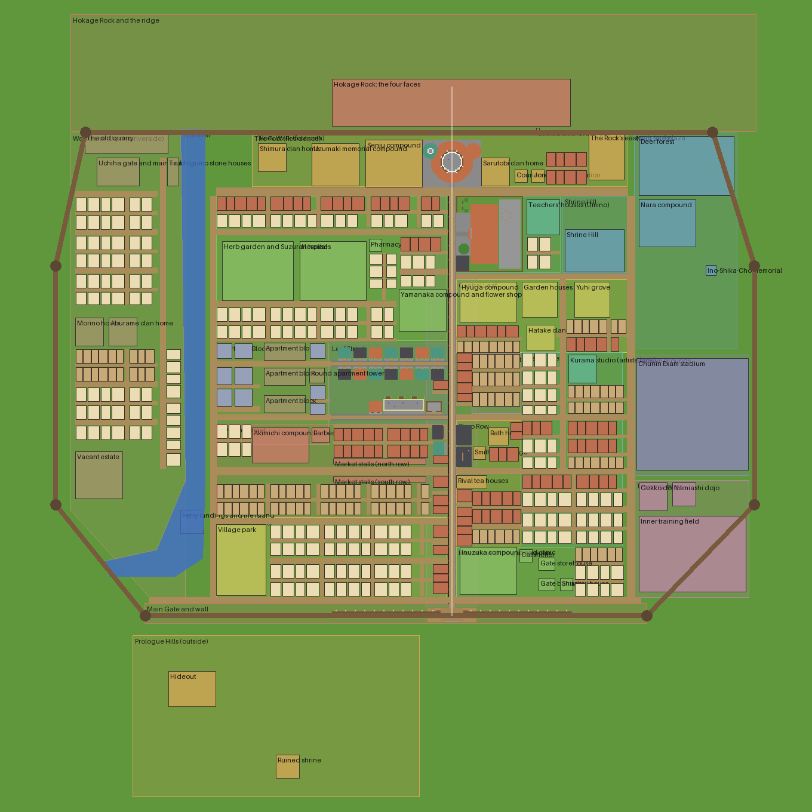

# Konoha master plan

The whole Hidden Leaf planned as one city before more building: its frame, districts, streets,
landmarks and sightlines, terrain, density, where people live and work, and where every story place
and quest anchor sits. Spoiler-free: places are named by purpose only.

Read with [DISTRICTS.md](DISTRICTS.md) (one sheet per district), [TECHNIQUES.md](TECHNIQUES.md)
(how to build it: proportions, palettes, depth, roofs, interiors) and [BATCHES.md](BATCHES.md) (the
ordered build list). The scope (counts, slices, the block catalogue) stays in
[KONOHA_BUILD.md](../../KONOHA_BUILD.md); the beta schedule in [ROADMAP.md §6](../../ROADMAP.md#6-the-map).

*The plan view: built plots drawn from their blueprints, planned footprints as boxes, the wall ring
with its towers in brown, the river in blue, the white line the view axis from the gate to the faces.
Data: [master_layout.json](master_layout.json) (layout.json's format); batch K5 merges it into
`tools/konoha/layout.json`, and `layout.py --plan` then draws this view.*

## 1. The frame

Konoha is a walled fan of streets below a cliff. Four fixed lines hold the whole plan:

| Line | Where (x east, z south, from the map origin) | Why |
|---|---|---|
| **The view axis** | Main Street, x = 57, from the main gate (z 177) to the Hokage Residence (z -176) | From the gate the Residence and the four faces stand straight ahead, framed by the street; canon's first view of the village |
| **The Rock** | The cliff face runs along z = -222 from x -262 to 312; the four faces sit centred on the axis, x -43 to 156, high on the cliff | The Residence sits right below the faces; every street sees the Rock |
| **The wall** | A ring of straight runs with a watch tower at every corner: the south front along z 179-185 (the main gate at its middle), diagonals to the west and east sides (x -275 and 310), meeting the ridge at both ends | The Rock's ridge is the village's north wall; the built wall is the south front, x -43 to 157 |
| **The river** | Falls from the ridge west of the faces (x about -160), runs south in a stone channel, widens into the ferry reach (z 70-135), leaves through a water gate in the south-west wall | The river, the old bridge, the ferry, the island and the riverside homes all sit on it, and it separates the walled west bank from the centre |

Inside the wall the village is about **585 blocks east to west and 405 north to south** (the Rock to
the gate). Sprinting across takes about two minutes. The current world border (660, centred on the
built street) is the Beta 1 test map; the shipped map grows it to about 1,200 when the outside
(training grounds, the Forest of Death, the east road) is built, as ROADMAP §6 plans.

**Scale.** Heights and rooms 1:1 with a 1.8 m player (a block is a metre; doors two high, rooms
three to four inside, storeys four to five floor to floor). Distances are compressed: canon's
several kilometres become a city crossed in two minutes. [TECHNIQUES.md §1](TECHNIQUES.md#1-proportions)
holds the numbers.

## 2. Districts

Rings from the Rock outwards. Bounds are the district polygons in the draft; every district has its
sheet in [DISTRICTS.md](DISTRICTS.md).

| District | Bounds (x, z) | Character | Height | Status |
|---|---|---|---|---|
| Hokage Rock and the ridge | -262..312, -320..-222 | Cliff, the four faces, forest on top (left wild) | 45-106 cliff | Planned (K11) |
| The Foot | -110..204, -221..-176 | Civic heart under the faces: the Residence, the founders' and allied clans, the courier office, the Rock's stair | 1-3 storeys, the Residence 5 | Residence built (K1) |
| Shrine Hill | 150..204, -168..-104 | The shrine on its hill, woods behind it | Hill +6 | Planned |
| Central Leaf | 61..204, -98..-37 | Old estates: the Hyuga, garden houses, small clan homes | 1-2 storeys | Planned |
| Hospital Hill | -140..53, -168..-47 | The hospital on a raised terrace, herb gardens, the Yamanaka flower shop on Main Street | Hospital 5 storeys; homes 2 | Planned |
| Academy | 61..148, -168..-104 | The Academy at the Rock's foot beside the Residence (canon), its yard and swing tree, teachers' houses | 3 storeys | Built (K1) 100 blocks south; K5 moves it here |
| Leaf Street | -45..53, -45..22 | The player's apartment block and the first residential street | 2-4 storeys | Built (K1) |
| Apartment Blocks | -140..-46, -45..40 | Walk-up blocks and a round tower: the skyline's shinobi housing | 4-6 storeys | Planned |
| Main Street | 36..78, -175..176 | The commercial spine: continuous two- and three-storey shop-houses | 2-3 storeys | Shops built (K2) |
| Civilian Market | -140..53, 23..100 | Market Street with stall rows, townhouse rows, the Akimichi and the barbecue house | 2 storeys, dense | Ichiraku and the grocer built |
| Shop Row | 61..115, 20..125 | The east side of the market: workshops, the smithy, the rival tea houses, the bath house, the inn | 2-3 storeys | Furniture and weapon shops built |
| South Residential | -140..53, 101..168 | Family streets, the park by the river | 1-2 storeys, gardens | Planned |
| Inuzuka and the gate quarter | 61..200, 126..168 | Kennels and clinic, the barracks and storehouse, gate homes | 1-2 storeys | Planned |
| East Quarters | 116..200, -37..125 | Quiet lanes: small clan homes, the artists' lane, family homes | 1-2 storeys | Planned |
| Nara forest | 210..296, -221..-40 | The Nara compound and the deer forest against the ridge | Low, wooded | Planned |
| Stadium grounds | 210..306, -35..66 | The Chunin Exam stadium | 4-5 storeys of stands | Beta 3 |
| Training lanes | 210..306, 70..168 | Dojos and an inner training field | 1-2 storeys | Beta 2 |
| West bank | -262..-166, -221..168 | Across the river: the walled Uchiha quarter, the old quarry, riverside houses, quiet dark lanes | 1-2 storeys | Planned |
| Main Gate and wall | -200..220, 173..190 | The gate, its towers, the south wall | Wall 20 (the built module), towers 26 | Gate and 10 wall modules built |
| Outside the wall | Around the ring | Prologue hills (south), training grounds and the lake (south-west), the cliff ground (west), farms and the east road (south-east), the Forest of Death (east) | Terrain | Beta 1 to Beta 3 |

## 3. Streets

Streets are axis-aligned centre lines with an odd width (`layout.json` rules). Three classes:
**main** (7 wide: a 5-block carriageway and kerbs; poles every 12 blocks, lamps), **lane** (5 wide),
and **alley** (3 wide, between plots, not in the layout: part of each block's design).

| Street | Class | Runs | Joins |
|---|---|---|---|
| Main Street | main | x 57, z -175 to 176 | The gate to the Residence (built) |
| Rock Road | main | z -172, x -140 to 204 | The Foot's front: the Residence forecourt, the clans, the stair plaza; crosses the river near the falls |
| East Avenue | main | x 207, z -168 to 168 | The east side's spine: Nara, the stadium, the training lanes, the gate quarter |
| Market Street | main | z 62, x -140 to 53 | Main Street to the river: the market's stall rows |
| Leaf Street, Sakura Lane | lane | z 17 and -28 | Built east of x -44; extended west to River Road; Leaf Street continues east to East Avenue |
| Shop Lane | lane | z 62, x 61 to 204 | Market Street's eastern continuation |
| Academy Street | lane | z -101, x 61 to 204 | The Academy's south side, the shrine steps, Central Leaf's north edge |
| Hospital Road | lane | z -138, x -140 to 53 | The hospital terrace's foot |
| South Lane, Haruno Lane | lane | z 104 and 137 | The family streets |
| Wall Lane | lane | z 170, x -196 to 215 | Just inside the south wall, the guards' round |
| River Road | lane | x -143, z -168 to 168 | The east bank promenade |
| Uchiha Road | lane | x -185, z -200 to 60 | The west bank, outside the Uchiha wall |
| Artists' Lane | lane | x 150, z -98 to 60 | The east quarters' quiet lane |

**Crossings.** Four bridges cross the river: a stone bridge on Rock Road below the falls, **the old
bridge** (arched timber, the oldest in the village) on Sakura Lane's line, a flat bridge on Leaf
Street's, and a footbridge at the north end of the ferry reach. Where the reach is too wide to
bridge, **the ferry** crosses from a landing on each bank.

**Street rules.** Every crossing of two main streets gets a small square (notice board, a well, a
tree, a lamp). Lanes end in a view (a shrine gate, a tree, a tower, the Rock), never a blank wall.
Main Street and the market keep their roofs within three blocks of each other, so the rooftop
route runs unbroken from the gate to the Foot.

## 4. Landmarks and sightlines

| Landmark | Site | Seen from | Holds |
|---|---|---|---|
| The four faces | The cliff above the Residence, x -43 to 156, high on the face | Everywhere: the main gate, every north-south street, the apartment blocks' balconies, the shrine hill | Keep every building on the view axis lower than the line from the gate to the faces' chins |
| Hokage Residence | Built, x 33-81, z -215 to -176 | The whole of Main Street | The round tower with 火 on the roof at the axis's end |
| Main gate | Built, x 37-77, z 177-188 | Main Street's whole length; the prologue hills outside | The あん doors, the guard booth |
| Ninja Academy | x 61-116, z -168 to -105 (moved from z -120..-57 in K5) | Main Street's north end, beside the Residence across Rock Road | The swing tree out front faces Main Street |
| Hospital | x -70 to -15, z -130 to -81, raised 4 | Main Street through the Yamanaka gap; the west bank | The tallest white mass west of the axis; flat roof with tanks |
| Shrine | Shrine Hill, x 152-201, z -140 to -105, raised 6, woods behind | Academy Street ends at its torii; from its top, the whole village | The steps, the hall, the bell, the wish plaques |
| Round apartment towers | One in the Apartment Blocks (x -62), two later in the east | The skyline from the gate and the shrine | Canon's cylinders: break the roofline left and right of the axis |
| The falls | The ridge's south face at x about -160 | The west half; Rock Road's bridge | The river's source; a pool at its foot |
| Chunin Exam stadium | x 212-305, z -32 to 61 | East Avenue; the shrine hill | Beta 3 |
| Water tanks | On flat roofs everywhere (two or three a block) | The skyline | Canon's signature roof clutter |

**Height rule.** Nothing on Main Street, the Foot or Central Leaf stands taller than 16 blocks except
the Residence (36 with its fins, as built) and the Academy (20); towers and the hospital stand off
the axis. **The sightline sets the Rock's height:** from an eye in the gate (y 65.6, z 182) the line
to the faces' chins must clear the Residence's top (y 100 at z about -195), so the chins sit at y 115
or higher. Four faces 50 wide need about 45 rows each, so the faces run from y 115 to 160 and the
Rock's top stands at about y 170 (106 above the street). The first draft's 134 would have hidden the
chins behind the Residence.

## 5. Terrain

The core of the village is flat at the map's ground (y 64): everything built so far stands there.
Height changes come at the edges and at the landmarks, so the core never needs re-pasting.

| Place | Height | How |
|---|---|---|
| The Rock | Rises from y 64 to about 170 at the faces (the faces from y 115 to 160), falling to about 110 at the ridge's ends where the wall meets it | A sheer face with ledges and buttresses below the faces, scree and pines at its foot; forest on top |
| Rock Walk | A 3-block stone path along the cliff's foot | The sealed door opens onto it, east of the Residence, hidden from the stair by a buttress |
| The Rock's east stair | Climbs the ridge's east flank from the plaza at Rock Road (x 172-201) to a lookout above the faces | 3 wide, landings every 6 steps, stone lanterns at the landings |
| Shrine Hill | +6 | Retaining walls of stone brick, a 3-wide stair of 12 steps with two landings, the torii at the foot on Academy Street |
| Hospital terrace | +4 | A stone-faced terrace with a broad ramp-stair from Hospital Road, so stretchers come up |
| The river | Water at y 62 (two below the street), the bed at 59 to 60 | A stone channel with steps down to the water in the village; natural reed banks outside the wall; the falls drop about 30 from the ridge into a pool |
| West bank | +2 | Bridges arch over the channel; the Uchiha wall on its own low rise |
| Nara forest | Rolls from +0 to +6 toward the ridge | Old trees, clearings for the deer |
| Outside | The prologue hills roll to about +25; the training grounds hold a lake (water at y 63) and a 25-block cliff | Hand-finished after a heightmap draft (KONOHA_BUILD.md §5) |

The terrain is pasted before the plots by a terrain pass (batch K6), which also replaces the
first-start grass fill that walks the border block by block.

## 6. Density, people and work

About **300 residents** when the whole village is built, about 200 in the beta's districts
(ROADMAP §6). Today: 29.

| District | Homes | Residents (target) | Workplaces |
|---|---|---|---|
| The Foot and Central Leaf | Clan halls and estates, the garden houses | 25 | Mission Desk (3, B2), jonin standby (6, B2), courier office (4), shrine (2) |
| Hospital Hill | Hill homes, the herbalists' houses, the Yamanaka | 20 | Hospital (6 medics, day and night), pharmacy, flower shop |
| Academy | Teachers' houses | 8 | Academy (5 teachers), the workshop |
| Leaf Street | The Leaf Block, Sakura Lane (built) | 30 | Tea house, training yard |
| Apartment Blocks | Three blocks and a tower | 45 | Ground-floor shops of the tower |
| Main Street, Market, Shop Row | Keepers above their shops, townhouse rows | 70 | Every shop and stall, the bath house, the inn, the smithy |
| South Residential | Detached homes | 40 | The park keeper |
| Inuzuka and the gate quarter | The compound, gate homes, the barracks | 25 | Clinic, kennels, gate booth (2), barracks (6 bunks), wall towers (night watch) |
| East Quarters and Nara | Clan homes, family homes | 30 | Dojos, the artists' studio |
| West bank | The Uchiha quarter, riverside and dark lanes | 25 | The ferry, the quarry |

Density by district: **Main Street and the market** continuous frontages (no gap wider than an
alley), every ground floor a shop; **residential streets** detached homes on 11-block plots, a
third of each plot garden; **apartment blocks** 4 to 6 storeys with galleries; **clan quarters**
walled, low, mostly garden; **the edges** forest and fields.

## 7. Story places and quest anchors

Places the story and the missions need, by site. Names only; what happens there stays in
`docs/story/`. Anchors are the missions' and the story's place tags (KONOHA_BUILD.md, Mission anchors).

| Place | Site | Slice |
|---|---|---|
| The prologue hideout, a ruined shrine | Prologue hills, outside the south wall | Beta 1 |
| A sealed door at the Rock's foot | Rock Walk, x 128-130, z -225; out of the stair's sight | Beta 1 |
| The Rock's east stair and its landing | The ridge's east flank from the stair plaza | Beta 1 |
| The Academy grounds, yard, library and archive | Academy | Beta 1 (built in part) |
| The shrine's steps, hall, roof and wish plaques | Shrine Hill | Beta 1 |
| The old bridge | Over the river on Sakura Lane's line | Beta 1 |
| Rooftop routes | Main Street, the market, the apartment galleries | Beta 1 |
| The ferry and the river island | The ferry reach | Beta 1 |
| The hospital desk and ward | Hospital | Beta 1 |
| The gate, its travel desk and the storehouse | Main gate, the gate quarter | Beta 1 |
| The market's stall, grocer, tea, oil and fish places | Market Street, Shop Row | Beta 1 |
| The Mission Desk, the records room, the council gallery | Hokage Residence | Beta 2 |
| A blank square wall for a later mural | The square where Market Street meets River Road | Beta 2 |
| The bath house and its boiler | Shop Row | Beta 2 |
| The memorial stone | Training Ground 3, outside the south-west wall on the river | Beta 2 |
| The old quarry and what lies under it | The west bank's north corner, cut into the ridge | Beta 2 |
| The lake | The training grounds outside the south-west wall | Beta 2 |
| The east road, its bridge, ford and waystation | Outside the gate, east | Beta 2 |
| The village inn | Shop Row, on Main Street | Beta 2 |
| The stadium | Stadium grounds | Beta 3 |
| The Forest of Death and its tower | Outside the east wall | Beta 3 |
| Clan places (Nara forest, Aburame garden, Yamanaka shop) | Their quarters | Beta 2 |
| Generic anchors (client homes, roofs and gardens, vacant homes, hiding spots, pet hideouts, overgrown lots, storerooms, warehouses, the park) | 4 to 8 per kind, spread over the residential districts | Beta 1 to 2 |

## 8. Reference check

The owner's reference builds (October 2026; inspiration, not copies) checked against this plan and
the K1 renders. What they confirm: the Residence centred under the faces at the end of the gate's
axis; a ring wall far lower than the Rock; dense one- to three-storey blocks broken by the Residence
and round towers. What they changed in the plan:

| Finding | Change | Batch |
|---|---|---|
| The Rock dominates every view; its faces are the village's biggest object | The Rock rises to about y 170 with the faces from 115 to 160 (§4) | K11 |
| Green canopy fills every gap between buildings; the K1 street reads bare | A tree budget: a big broadleaf every 15 to 20 blocks along every street, one or two per home plot, groves in every square and clan garden ([TECHNIQUES §9](TECHNIQUES.md#9-trees-and-gardens)) | K6 and each district's batch |
| Round buildings of every size, not one tower: drums and tiered round towers with stepped roofs | A round-building family (drum house, round shop, tiered tower) used in every district, about one in twelve buildings ([TECHNIQUES §4](TECHNIQUES.md#4-roofs)) | K7 onward |
| Roofs in many colours: teal and blue beside green, orange and grey; flat grey roofs crowded with white tanks | Teal and blue roof palettes added; flat roofs carry two or three tanks | K4 onward |
| The gate's two green doors fill the whole opening; ours are narrow strips beside it | The doors as tall and wide as the opening, standing open inward; the あ and ん large on them | K4 |
| The wall reads warm orange-brown from inside the village; ours is dark spruce and packed mud | The wall's boards shift toward orange-brown (stripped acacia, terracotta) *check against the art* | K4 |
| The Residence stands in a round sandy forecourt with curved stairs and lanterns; ours sits on a grey square | A round forecourt of packed earth and sandstone, curved steps down to Rock Road | K4 |

## 9. Quality bar

Every building from here on meets [TECHNIQUES.md](TECHNIQUES.md): canon silhouette first (checked
against reference art), proportions true to the player, depth on every face (frames proud of the
walls, recessed openings, eaves that cast shadow), textured walls (a gradient, not one block), and a
lived-in interior for every home a resident sleeps in. Renders before paste; a client screenshot
after.
